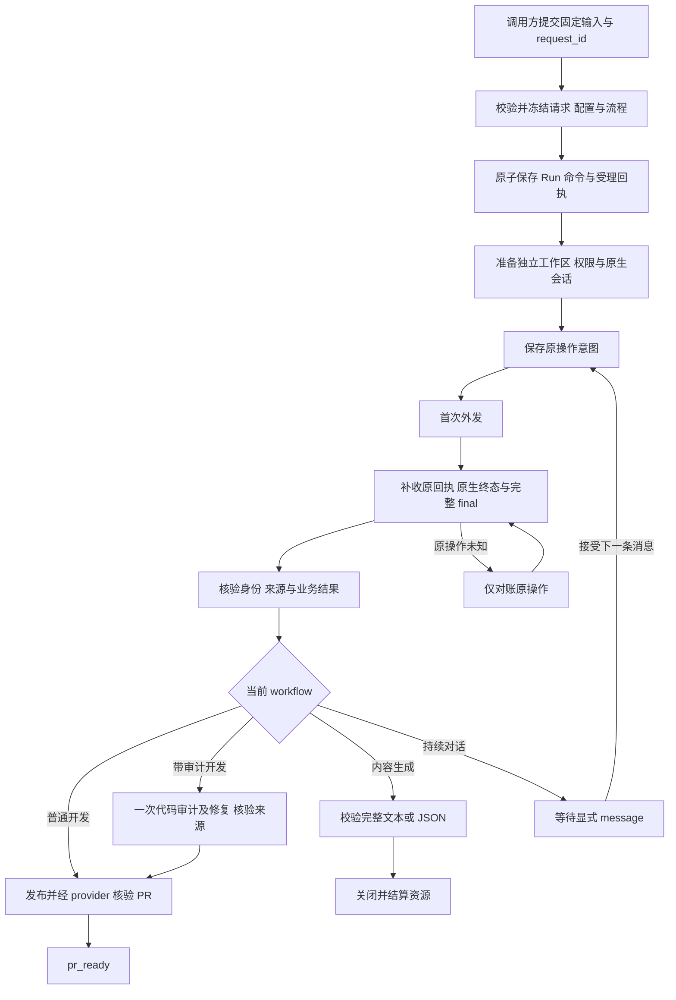

# SteerRunner 可靠性交付链路

Orca 原会话关闭与额外资源清理分别处理：关闭成功后允许业务收尾及按冻结 scope 核验，额外清理不保证且不构成新门禁；关闭本身未知仍保持未知。现行责任、文件变量绑定和重启/部署规则统一见[Orca 执行链路设计](orca-execution.md)。

能力和可靠性承诺统一维护在[长期产品承诺](spec/steerrunner.spec.md#长期产品承诺)；本文解释实现链路和历史分析，不另立承诺。本机 Orca Codex 已按[现行长期承诺](spec/steerrunner.spec.md#现行停止范围本机-orca-codex)收敛停止范围，证据及限制见[专项验收](archive/2026-11/implementation/acceptance/orca-local-codex-stop-simplification.md)。

> 2026-11-01：当前运行指引已按[个人执行器简化](archive/2026-11/implementation/spec/personal-executor-simplification.spec.md)及停止条件收敛更新为 v8、升级先排空和人工对账。下文历史调查基线、试验、验收引用保留原范围；P1–P4 资格分别见[总状态](archive/2026-11/implementation/spec/personal-executor-simplification.plan.md#71-本轮总状态与交付边界)，不表示外部 SteerLine 已联验。

日期：2026-10-21。代码基线：`8261310`。面向 SteerRunner 维护者与 SteerLine 接入方。

合并前已同步 Runner 主干 `966fcef`（#43/#45）和调用方主干 `534ea902`（#372/#373）。下文当前行为按这些增量理解：开发文档使用 worktree 内路径，内容上传材料仍保留自己的冻结与核验；实际受理完整绑定、原子 observe 及调用方部署准备沿主干实现，原始试验仍只证明各自固定构建。

SteerRunner 的可靠性交付需要回答四件事：请求是否收下、原动作实际发生了什么、结果是否满足交付条件、资源是否已经结算。它们可以共用查询入口，但不能用一个成功回执相互替代。

**已实现的快速路径和原命令对账不再作为新增改造立项；结果获取和校验优化须先验证收益。** 普通开发的正常路径可以只有实施、发布两次业务模型输入；同构建服务重启可以接回原执行，升级须先由原版本排空。未知发送只对账、原结果来源核验、PR 平台核验和现行后端范围内的停止证据仍是必要边界。第 6 节保留已实现能力的原依据，第 7–8 节链接原分析与批次，不自动形成新的待办；已完成的观测解耦、定向验证和职责收口以当前总状态为准。

## 1 交付范围与责任

| 所有者 | 应交付的事实 | 不由它证明的事情 |
| --- | --- | --- |
| SteerLine 或独立调用方 | 选定 workflow、执行机和固定输入；保存 request_id；处理业务决策 | Task、DAG、Candidate、最终 TaskDelivery 的管理不下放给 Runner |
| Workflow | 根据可信原结果选择补报、审计、发布或等待用户；保存唯一业务游标 | 不自行决定未知副作用能否重发 |
| application 与 storage | 受理命令、授权与撤销、操作意图、Run/命令/事件的原子提交、公开投影 | 内存状态、CLI 退出码不能替代持久事实 |
| reliable 与 adapter | 原操作执行或对账、精确身份、原 session/turn/final、停止事实 | 原生完成不直接等于业务成功 |
| 独立 execution owner | 保留本机原生连接、Job/工具树；服务离线时保留原证据 | 不持有数据库或决定 Workflow 后继；独立 parser 是自身管理的内存文本任务，宿主登录不由 owner 撤销 |
| Orca 创建执行器 | 在 Runner 主机上执行一次冻结的公开 create，并保留原创建回执 | 不是远端 helper，不负责业务调度，也不保证无回执时找回资源 |
| PR provider | 实际 PR、仓库、base/head、状态及适用的提交身份 | agent 给出的 URL 只是候选线索 |

开发交付以 `pr_ready` 为 Runner 里程碑；合并观察与 TaskDelivery 分别处理。`pr_ready` 不保证执行资源已停止。内容生成交付完整 text/JSON 及资源结算；持续对话每轮交付结果后等待显式 message。

完成语义分别适用：generate 已取得成功结果但 cleanup/stop 未结算时，不能显示全部完成；conversation 回合结束不表示会话关闭或业务成功。核心 Run/回执/操作及停止状态查询按公开契约返回已提交事实，失败明确报错；可选进度、日志采集、用量及 Viewer 实时性才适用尽力提供。服务重启可能丢失独立 parser 的未提交内存结果，重新取得业务资格后可按当时配置重算并产生重复费用，不保证跨重启的总次数、总费用、模型或输出一致；该例外不允许重做原业务执行。边界统一见[长期产品承诺](spec/steerrunner.spec.md#长期产品承诺)。

当前主链使用 state/v8、SQLite user_version=8、默认 `%LOCALAPPDATA%/SteerRunner-v8`，流程保持 development/2、development-audited/2、conversation/1、generate/1、execute/1。v7 及更旧目录非破坏拒绝，由原版本查询和结算。同构建重启保留原授权；升级先排空，不提供跨构建活动任务接管。当前职责与恢复边界以[个人执行器简化 Spec](archive/2026-11/implementation/spec/personal-executor-simplification.spec.md)为准；本文旧日期记录不授予当前构建资格。

## 2 正常交付链路

图中核验、提取和提交通常是程序行为，不各占一次模型调用。开发阶段结果无法判断时，才按冻结策略进入有次数限制的补报；明确业务未完成时等待用户；技术未知或来源冲突保持对账/阻断。

### 2.1 接受和冻结

调用方通过 v1 写信封提交稳定的 `request_id`。Runner 校验支持组合、请求字段和固定仓库基线，冻结请求、提示词、模型、权限、目标、资源摘要与相关预算，持久化后才返回受理回执。开发仓库的缓存引用可在接受前刷新，固定 base commit 不随最新分支移动。开发 Spec/Plan/参考材料固定为 worktree 内仓库相对路径，由 agent 读取；Runner 不再复制文档快照或把文件存在性、内容散列作为开发派发与恢复门槛。内容 workflow 的上传材料继续冻结原字节并核验，不与开发路径混用。

同一 ID、同一正文找回原命令；同一 ID 改正文冲突。响应丢失先按原 request_id 查询。客户端重放相同信封用于找回原受理结果，不等于授权再次执行外部动作。

`capabilities` 和 `validate` 可用于配置发现与预先诊断；它们不是每次 submit 前的强制步骤。纯 validate 成功只说明输入合法，不能证明执行环境或发布权限已就绪。正式 submit 仍执行生产准入校验。

来源：[独立配置契约](spec/independent-configuration.spec.md)、[基线刷新验收](archive/2026-11/implementation/acceptance/repository-base-refresh.md)、[冻结入口](../internal/application/freeze.go)。

### 2.2 准备和首次派发

开发 Run 准备自己的工作区和分支，核验固定 base/head、目标和权限。本机及 Orca local 开发路径直接使用执行主机已有 Git/gh/SSH 登录；新远端 Run 使用已有 Orca 原生认证。内容 workflow 使用本机 read_only，不要求开发仓库、Spec/Plan 或 publication。

**首次副作用前先持久化原操作 ID、输入摘要和身份绑定。** 新提交的意图才进入 Execute；已有的 in_flight、accepted pending 或 outcome_unknown 进入原操作 Reconcile。重启后即使怀疑“上次还没来得及调用”，也不能把普通 in_flight 当作未发送。独立 parser 是内存文本任务，不属于原生操作账本，其生命周期不能推广为业务动作的未派发判断。

原 Run/Attempt、配置、resource generation、session、command/turn 和输入来源共同约束回执归属。原生受理输入和开始回合分别核实，不凭终端出现文字判断已经启动。

来源：[操作执行规则](../internal/execution/reliable/operation/effect.go)、[原意图记录](../internal/execution/reliable/operation/record.go)、[派发宿主](../internal/application/worker.go)。

### 2.3 补收和结果获取

Runner 先取得原回合终态和完整可信 final，再形成业务结果。原生失败、完整 final 缺失、原操作未知或来源冲突，不能靠模型补一句“完成了”解除。带审计流程还核验原完成时的 Git checkpoint；不能拿恢复时的当前 HEAD 补成历史完成证据。

结果获取按具体 workflow 选择：

| Workflow | 正常业务输入 | 结果获取及边界 |
| --- | --- | --- |
| development/2 | 实施 → 发布 | 可信成功行和必要核验通过可跳过补报；无法判断时每原实施、每原发布各最多补报一次；不调用独立 parser |
| development-audited/2 | 实施 → 一次代码审计及 P0–P2 修复 → 发布 | 实施/发布沿同样的快速路径；审计结果先程序提取，可选一次独立 parse，仍不足时按资格最多一次原审计补报 |
| generate/1 | 一次生成 | 完整 final；配置 output_schema 时校验单一 JSON 值；无补报、parser、自动修复或重新生成 |
| conversation/1 | 首条输入及各次显式 message | 每轮保存完整 final 和原生来源；一轮结束进入 input，不自动发送下一轮 |

补报只整理已有工作；parser 只整理冻结材料。二者都不应补做实施、审计、测试或发布。parser 失败后只有原资源已结算、原授权仍有效且预算允许，才可转原 agent 补报。未知 parser 先对账，不能同时启动补报。

development-audited 当前是一次审计内完成修复，已经没有 Spec 审计、独立自动返修阶段或自动再审循环。未解决的 P0–P2 和未完成验证会阻止发布。新实施或反馈改变源后，旧结果和审计资格失效。

来源：[普通开发](workflows/development.md)、[带审计开发](workflows/development-audited.md)、[结果获取](spec/result-acquisition.spec.md)、[生成](workflows/generate.md)、[对话](workflows/conversation.md)。

### 2.4 PR 核验与交付

发布输入只发送一次。程序从原结果取得唯一 PR 候选，再由 provider 核验 URL、仓库、base、head 仓库/分支和实际状态；带审计流程还要求 PR HeadRevision 对应已核实的审计后提交。

PR 线索可以提前独立绑定，便于观察已经发生的外部事实；绑定线索不自动代表 Workflow 完成。最终核验通过才提交 `pr_ready`。发布结果未知或 PR 查询失败时对账原目标，不重新 push 或创建另一个 PR。`merged` 是另行取得的外部事实，不能由成功行、CLI 退出码或 pr_ready 推导。

来源：[发布核验](../internal/application/results.go)、[PR 身份规则](../internal/execution/publication/pr.go)、[结果前置条件](../internal/execution/workflow/verification.go)。

## 3 各种回执分别证明什么

| 回执或证据 | 可以证明 | 仍需等待或核验 |
| --- | --- | --- |
| CLI accepted 与 command_id | 原命令已持久受理 | 执行是否开始、动作是否完成；看 command 的 action_status 和 Run |
| Operation accepted/confirmed | 该 action 契约所定义的受理或完成 | confirmed 必须结合 action 解读；准备完成不等于实施完成 |
| Orca input_accepted / turn_started | 绑定原请求的宿主受理与开始观察 | 原生 Codex 的冻结正文及业务开始须由原线程输入/turn 证明；另需终态、完整 final、业务完成 |
| 原生终态与 final verified | 原回合及完整最终输出的来源可采信 | 业务结果、审计与 PR 条件 |
| 获取结果 satisfied | 原来源形成了满足获取契约的业务结果 | 当前源是否仍适用、下一业务边所需的其他条件 |
| PR provider 核验 | 实际 PR 的身份与查询时状态 | 不自动证明合并、TaskDelivery 或资源停止 |
| stop 命令受理 | 已提交撤销后续输入授权的停止意图 | 已在途动作的结果、原资源停止与结算 |
| stop_status / resources_settled / verify-stopped | 在各自报告 scope 内取得停止或结算事实 | 不能超出 scope 推断远端 OS 全树、宿主登录等状态 |
| 人工 resume 的 action_status=completed | 原事实已核实且符合当前控制资格，技术暂停已解除 | 不代表业务问题已回答、业务成功或资源停止；无效原资源不能重建 |

这些层次可以在界面上汇总为一个进度，但必须保留分项。事件也要先成功落库，再向原观察端确认；先确认后落库会使崩溃后丢失唯一事实。重复事实幂等处理，冲突和陈旧事实不推进当前源。

## 4 异常与恢复决策

先判断“原动作是否可能已经发生”，再核对原资源及用户授权。未知创建/输入沿原准备期限只读对账，没有共同期限时最多 30 秒；耗尽转 blocked/manual_intervention_required、resume_required=true，轮询不重开窗口。显式 resume 持久受理后最多 30 秒只读核实原操作；原事实解决 unknown 且原资源有效才解除技术暂停，仍未知则 action_status=failed、可用新 request_id/当前 revision 再查。同 ID 回放原结果；期限不因重启或保存失败续期。resume 不重发输入、不创建替代资源，业务等待及 stop/close 保持。活动长回合、accepted/ResourcePending 和停止核实仍按各自原契约处理。

| 情况 | 当前应走的流程 | 可以自动进行 | 必须停住的边界 |
| --- | --- | --- | --- |
| submit/reply/message/stop 响应丢失 | 查询原 request_id，必要时重放完全相同的信封 | 找回原命令与进度 | 不换 ID 再发同一业务意图 |
| Orca 下一轮发送前，状态连接暂不可用 | 在原 transport.wait_timeout 内退避重连，恢复后重新核验原终端/工作区/provider session | 原身份仍一致且就绪时继续首次发送 | 认证拒绝、身份变化、等待/阻断或期限耗尽 |
| Orca repo list 命中特定缓存 rename 冲突 | 原只读查询最多 5 次，共用 15 秒期限 | 受限退避和取消 | 普通权限/认证错误不进入重试；该规则不适用于 create/send |
| 已尝试发送但响应/开始事实未知 | 只读对账原操作、原请求和原 session | 补收原回执 | 本地 ID 或普通 timeout 不提供 exactly-once 保证 |
| 原执行版本的服务正常退出或强杀 | 同构建重开后接回同 state-dir 的原 owner/资源与未完成操作 | 补收离线结果；原授权有效且证明未派发的唯一后继可接续 | 不批量 resume；暂停、人工等待、业务阻断、stop、closed、pr_ready 保持 |
| Orca 创建后、DB 尚未取得回执时服务退出 | 读取 Runner 独立创建执行器保存的原始回执，校验完整绑定后结算 | 原执行器留下可靠身份时找回原 worktree/terminal/control | 无回执、执行器也失效、回执损坏/异源时保持 unknown；不再 create，不按名字或列表认领 |
| 原执行资源丢失或原事实查询预算耗尽 | 转待人工；显式 resume 仅有界核实原事实，仍不可用则保持暂停 | 补收已保存原回执/final，不自动解除人工阻断 | 不新建 Attempt、owner、终端或替代 session；需要新执行由用户明确创建新 Run |
| 程序提取不到业务结果 | 按当前源的冻结策略和剩余次数补报；仅审计可选择独立解析 | 在资格满足时完成尚未派发的获取 | 原失败/来源冲突/技术未知不能靠补报“修好” |
| 已明确实施未完成 | development 进入 waiting_input，保留已知原因 | 展示结果和问题 | 无明确用户输入不自动实施 |
| 保存的答案跨服务换代 | 核验原问题、原执行范围、来源和授权绑定 | 新规则下合法且未发送的原答案可续投 | 旧 epoch 答案、问题变化或错会话需人工确认；未知发送只对账 |
| stop 与完成结果竞争 | 撤销与派发经 gate/CAS 排序；晚到结果仍可记录 | 对账已经发生的原动作 | 撤销提交后不生成新补报、审计、发布或其他业务输入 |
| PR 查询失败或源提交变化 | 查询同一 PR，重新核验当前适用的结果/审计来源 | 补收外部事实 | 不从旧审计推出新 HEAD 已通过，不重新发布补查询 |
| 服务启动结果 startup_unverified | 核实原 bootstrap 对应的精确进程 | 原启动事实对账 | 不再启动第二份服务 |

前述“证明未派发”不等于“DB 没有成功回执”。普通操作一旦保存为 in_flight，跨重启就按可能已调用对待；尚未转为外发操作的业务后继才按原授权及来源判断。独立 parser 重启后的文本任务沿自身源/预算资格处理，不重建持久 parser pending，也不能授权重做原业务执行。

创建执行器缩小了“服务丢失创建响应”的恢复窗口，但没有消除外部系统不提供持久创建关联时的不可判定性。当前已有 Runner 内部保留回执与受控故障窗口证据；不能宣称在 Orca、CLI、创建执行器同时失效时仍能任意找回。来源：[创建恢复追补](archive/2026-11/acceptance/pr-test-gaps-20261020.md)、[创建执行器](../internal/execution/adapters/orcatransport/creation_owner.go)、[恢复资格](../internal/execution/reliable/recovery_policy.go)。

## 5 停止 关服务与更新

### 5.1 三种意图对应三条路径

| 用户意图 | 必要路径 | 完成条件 |
| --- | --- | --- |
| 停止这个 Run，或关闭持续对话 | 持久撤销输入授权 → 对账/停止原执行及取消适用的 parser → 按现行后端 scope 核实资源结算 | 分项停止证据成立；仅命令受理不算完成，不撤销执行主机已有登录 |
| 暂时关服务，稍后继续 | 脱离原观察和连接，保留原执行 owner、授权、游标和事实；重开接回 | 服务写者退出即可描述为服务已停，资源可继续运行 |
| 更新 Runner | 原版本停收新任务 → 完成或精确停止原 Run → 核实资源及未完成操作/控制已排空 → 停旧 writer → 启用新版本 | pr_ready/service stop 均不等于排空；本次 v7→v8 使用新目录，不携带活动任务接管 |

删除 state-dir、移除在用 runtime 或破坏性迁移需要对应资源停止/结算事实；无法确认时保留原 EXE/目录，由原版本和用户处理。`service verify-stopped` 是离线显式核验，需原 writer 已退出，其 scope 不扩大。`service verify-takeover` 已删除，普通未知命令 exit 2。此次 v7→v8 切新目录；未来格式/契约兼容且已排空时可继续原目录、查询历史，不因 EXE 变化强制换目录。

服务离线时调用方尚未送达的 stop 不属于 Runner 已接受命令。重开可经 `service start` 的 `pending_stops` 提交原 stop 信封，在 worker 启动前先受理；仍要检查各原命令结果，不能假定提交清单即已全部撤销。

### 5.2 停止证据的范围

本机 Orca 受管 Codex 保留 helper 协作停止及 Job 实际清理，核实登记的原业务/控制终端、helper 与 app-server 根身份，报告 `orca_local_codex_resources`。退出签名文件、control Closed 和 pending reader 响应不再决定停止成功；正常 history/Git/审计查询仍保留原来源和 reader 证据。停止总预算 15 秒，协作等待最多 2 秒；可能外发后只读核实原资源，不重复 helper 请求或 close。缺证明文件可成功，资源仍活、错身份或未知创建仍不能成功。scope 不证明全部后代退出；部分清理中断可转人工。

远端原生 Orca 的停止保证限于原 terminal scope，不能宣称远端 OS 全树退出或宿主 gh 登录撤销。本机停止一个 Run 也不应退出宿主 gh 登录或停止其他 Run。上述证据可以统一收集和展示，但不能相互冒充。

来源：[普通重启与升级排空契约](archive/2026-11/implementation/spec/personal-executor-simplification.spec.md#4-恢复与升级收缩pes-02)、[本机 Codex 现行停止规则](archive/2026-11/implementation/spec/orca-local-codex-stop-simplification.spec.md)、[离线停止核验](../internal/host/verify_stopped.go)。

## 6 已实现能力与可选流程

以下属于已有实现或现有调用策略，不再以“新增简化功能”重复立项。收益应按调用方实际使用情况计算，不能把具备能力当作所有现场都已使用。

| 已实现项 | 当前事实与入口 | 后续处理 |
| --- | --- | --- |
| 原命令统一查询与对账 | SteerLine `runnerbridge.Bridge.Step/deliver` 已按原 request_id 查询并保留 accepted、unknown、action_status；不是每个控制命令各有一套完整引擎 | 只核对剩余具体重复，不再新增同步等待层 |
| 普通开发快速路径 | [路由](../internal/execution/workflow/route.go)已支持成功声明或有效机器结果直接推进，不要求固定补报 | 保留正常路径 2 次业务输入的回归；不能把再次“启用快速路径”算作新收益 |
| 审计 JSON 直接获取 | 同一路由已对原审计 final 调用 DecodeReport，结构和来源通过后可直接进入发布 | 优化对象是原审计输出命中率，现有解析能力不用重做 |
| V1 审计默认提示优化 | 本轮原生零修复/有修复对比和跨构建旧提示保留/新 Run 默认测试通过后，已让新默认 audit.code 要求现有 JSON 契约；额外获取由样本基线合计 2 次降为 0 | 只改变提示文本，不加入原生 schema，不扩展支持矩阵；旧冻结文本、显式覆盖及后备保持 |
| parser 默认关闭 | [DefaultConfig](../internal/execution/resultacquisition/config.go) 的 Enabled 默认 false；只在审计结果不足且冻结配置显式开启时选择 parser | 默认路径已经没有 parser 启动成本；不再提出“默认关闭”改造 |
| 兼容服务自动接续 | 原授权、安全派发资格与相关契约满足时，接回原 owner/session 并补收结果 | 不再增加重启后批量 resume；保留真正资源丢失和人工等待分支 |
| 两处旧文档已修正 | README 的 state/v4/受控升级说明和 conversation 的兼容换代说明已更新 | 后续只清理仍有冲突的当前操作指引，历史验收不改写 |

SteerLine 审计与实施基线为本机 checkout `36d4f596`；其结论不表示其他安装版本已具备相同行为。已按用户授权在该调用方工作树实施只读摘要；原 `Bridge.Step/deliver`、actor/tick 和业务投递规则保留。逐项状态见[实施与验收](archive/2026-11/implementation/acceptance/reliable-delivery-simplification.md)。

下列步骤按任务需要选择，不应一律叠加成每次交付的固定前置：

| 项目 | 当前边界 | 调用方应如何使用 |
| --- | --- | --- |
| capabilities 与纯 validate | 配置发现、提前诊断；submit 自带生产校验 | 配置变化时发现能力，需要时预校验；无需每次依次调用三遍 |
| 独立代码审计 | development-audited 的业务选择 | 需要独立审计时选择；普通开发不应被自动升级成带审计流程 |
| 原 agent 补报 | 每源最多一次的后备获取方式 | 已取得可信充分结果就跳过；明确未完成不为确认失败再补报 |
| 独立 parser | 默认关闭；仅当前审计结果获取可选择 | 不为普通实施、发布、内容生成准备 parser 环境或增加解析回合 |
| 自动返修和再审 | 当前 workflow/2 已无这条循环 | 不在外部重新套一层固定“审计 → 返修 → 再审”作为 Runner 必经链路 |
| 同构建重启与人工 resume | 原授权及原资源资格成立时自动接回观察；技术待人工只由显式 resume 有界核实原事实 | 保留业务等待；升级先排空，丢失资源不能重建，未核实不授权后继 |
| R2 discover/collect/list/read 与 workspace-git | 按需证据与当前 Git 观察，不是每个 Run 的发布前必经步骤 | 交付确需文件证据时采集；list/read 读取已提交不可变副本；当前 Git 不能替代历史 checkpoint |
| 远端受管 helper | 新远端 Run 已沿 Orca 原生链路，不部署 Runner helper | 不把本机/Orca local 的认证和控制证明要求直接复制到原生远端 |

按没有人工续执行、没有业务失败的单次开发源计算，普通开发快速路径为 2 次业务模型输入；两处都需要补报时最多 4 次。带审计快速路径为 3 次；若依次需要实施补报、审计 parse、审计补报及发布补报，最多 7 次。这是策略预算推导，不是延迟实测。parser 未开启时直接沿现有补报分支；已显式开启但资格失败或结果未知时，仍按原失败/对账与资源结算规则处理，不能一概跳过。重启不刷新次数或绝对期限。

## 7 历史简化方案（2026-10-21）

D1–D3、V1–V5 的原调查、准入条件、成本比较和未展开项统一保留在[历史分析](archive/2026-11/maintenance/reliable-delivery.before-consolidation.md#7-历史简化方案2026-10-21)。它们不自动成为当前待办；现行承诺和已实施边界见[长期产品承诺](spec/steerrunner.spec.md#长期产品承诺)及本页正常链路。

## 8 实施顺序与验收条件

原批次顺序、摘要/审计试验、验收矩阵与计量规则见[历史方案](archive/2026-11/maintenance/reliable-delivery.before-consolidation.md#8-实施顺序与验收条件)；实际通过、失败及未验范围仍由[原验收](archive/2026-11/implementation/acceptance/reliable-delivery-simplification.md)与后续专项分别登记。文档精简不使未展开的方案成为已实现能力，也不重开已退役的跨构建接管验证。

## 9 当前依据与验证范围

正常链路以本节源码及现行[个人执行器 Spec](archive/2026-11/implementation/spec/personal-executor-simplification.spec.md)为准。2026-10-21 的纯投影/只读展示改动及原生试验按[当时验收](archive/2026-11/implementation/acceptance/reliable-delivery-simplification.md)记账；后续 P1–P4 的实施和资格分别见[总状态](archive/2026-11/implementation/spec/personal-executor-simplification.plan.md#71-本轮总状态与交付边界)，旧通过不自动扩展到所有后端或当前 HEAD。

简化方案审计轮及本次实施轮均运行 `go test ./internal/execution/workflow ./internal/execution/reliable ./internal/execution/reliable/operation -count=1 -timeout=90s`，三个包通过；这验证既有可靠性规则，不替代调用方摘要和 V1–V5 的各自验收。

| 主题 | 当前代码与契约入口 | 已有验收入口 |
| --- | --- | --- |
| 唯一状态权威、原子提交与幂等 | [Store](../internal/storage/store.go)、[操作规则](../internal/execution/reliable/operation/effect.go)、[执行边界](archive/2026-11/implementation/spec/execution-boundary-refactor.spec.md) | [边界收敛](archive/2026-11/implementation/acceptance/execution-boundary-refactor.md) |
| 同构建重启、升级排空及人工对账 | [Engine](../internal/application/engine.go)、[原操作对账](../internal/application/manual.go)、[现行契约](archive/2026-11/implementation/spec/personal-executor-simplification.spec.md#4-恢复与升级收缩pes-02) | [P3 验收](archive/2026-11/implementation/acceptance/personal-executor-p3.md)；[旧换代验收](archive/2026-11/acceptance/service-generation-recovery.md)保留历史范围 |
| 创建回执保留与 unknown | [创建执行器](../internal/execution/adapters/orcatransport/creation_owner.go)、[反例测试](../internal/execution/adapters/orcatransport/creation_owner_test.go) | [创建恢复追补](archive/2026-11/acceptance/pr-test-gaps-20261020.md) |
| 结果获取与审计来源 | [结果获取 Spec](spec/result-acquisition.spec.md)、[Workflow 核验](../internal/execution/workflow/verification.go) | [结果获取验收](archive/2026-11/implementation/acceptance/result-acquisition.md) |
| 内容流程与原资源重启 | [内容 Spec](spec/content-workflows.spec.md)、[当前恢复边界](archive/2026-11/implementation/spec/personal-executor-simplification.spec.md#4-恢复与升级收缩pes-02) | [P3](archive/2026-11/implementation/acceptance/personal-executor-p3.md)、[P4](archive/2026-11/implementation/acceptance/personal-executor-p4.md)；[内容流程](archive/2026-11/implementation/acceptance/content-workflows.md)及[旧接管](archive/2026-11/acceptance/content-takeover.md)按历史构建记账 |
| Run 资源结算 | [verify-stopped](../internal/host/verify_stopped.go)、[当前排空及人工对账契约](archive/2026-11/implementation/spec/personal-executor-simplification.spec.md#4-恢复与升级收缩pes-02) | [Check 退役边界](archive/2026-11/implementation/acceptance/check-retirement.md)、[Orca 原生远端](archive/2026-11/acceptance/orca-remote-native.md) |
| 按需证据 | [R2 说明](run-evidence-r2.md) | [R2 验收](archive/2026-11/implementation/acceptance/run-evidence-r2.md) |
