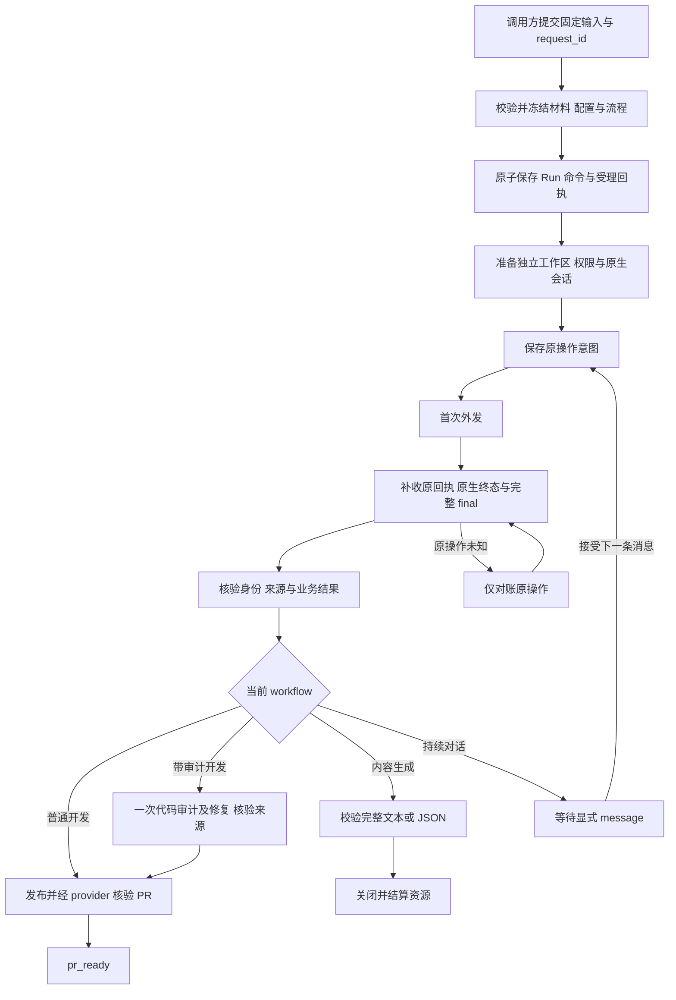

# SteerRunner 可靠性交付链路与简化分析

日期：2026-10-21。代码基线：`8261310`。面向 SteerRunner 维护者与 SteerLine 接入方。

SteerRunner 的可靠性交付需要回答四件事：请求是否收下、原动作实际发生了什么、结果是否满足交付条件、资源是否已经结算。它们可以共用查询入口，但不能用一个成功回执相互替代。

**已实现的快速路径和原命令对账不再作为新增改造立项；可以直接推进文档收敛与只读进度展示，结果获取和校验优化须先验证收益。** 普通开发的正常路径可以只有实施、发布两次业务模型输入；兼容服务换代可以自动接回原执行。未知发送只对账、原结果来源核验、PR 平台核验和精确停止取证仍是必要边界。第 6 节区分现有能力，第 7 节区分直接实施项和验证项，第 8 节给出批次与验收条件。

## 1 交付范围与责任

| 所有者 | 应交付的事实 | 不由它证明的事情 |
| --- | --- | --- |
| SteerLine 或独立调用方 | 选定 workflow、执行机和固定输入；保存 request_id；处理业务决策 | Task、DAG、Candidate、最终 TaskDelivery 的管理不下放给 Runner |
| Workflow | 根据可信原结果选择补报、审计、发布或等待用户；保存唯一业务游标 | 不自行决定未知副作用能否重发 |
| application 与 storage | 受理命令、授权与撤销、操作意图、Run/命令/事件的原子提交、公开投影 | 内存状态、CLI 退出码不能替代持久事实 |
| reliable 与 adapter | 原操作执行或对账、精确身份、原 session/turn/final、停止事实 | 原生完成不直接等于业务成功 |
| 独立 execution owner | 保留本机原生连接、Job/工具树、认证和适用的 parser；服务离线时保留原证据 | 不持有数据库或决定 Workflow 后继 |
| Orca 创建执行器 | 在 Runner 主机上执行一次冻结的公开 create，并保留原创建回执 | 不是远端 helper，不负责业务调度，也不保证无回执时找回资源 |
| PR provider | 实际 PR、仓库、base/head、状态及适用的提交身份 | agent 给出的 URL 只是候选线索 |

开发交付以 `pr_ready` 为 Runner 里程碑；合并观察与 TaskDelivery 分别处理。`pr_ready` 不保证执行资源已停止。内容生成交付完整 text/JSON 及资源结算；持续对话每轮交付结果后等待显式 message。

当前主链使用 state/v4、development/2、development-audited/2，以及 conversation/1、generate/1。旧文档中的 state/v2/v3 和“一律重启后手动 resume”不能直接作为当前操作指引。职责依据：[执行边界收敛](spec/execution-boundary-refactor.spec.md)、[服务换代恢复](spec/service-generation-recovery.spec.md)。

## 2 正常交付链路

图中核验、提取和提交通常是程序行为，不各占一次模型调用。开发阶段结果无法判断时，才按冻结策略进入有次数限制的补报；明确业务未完成时等待用户；技术未知或来源冲突保持对账/阻断。

### 2.1 接受和冻结

调用方通过 v1 写信封提交稳定的 `request_id`。Runner 校验支持组合、请求字段、固定仓库基线和材料，冻结输入、提示词、模型、权限、目标、资源摘要与相关预算，持久化后才返回受理回执。开发仓库的缓存引用可在接受前刷新，固定 base commit 不随最新分支移动。

同一 ID、同一正文找回原命令；同一 ID 改正文冲突。响应丢失先按原 request_id 查询。客户端重放相同信封用于找回原受理结果，不等于授权再次执行外部动作。

`capabilities` 和 `validate` 可用于配置发现与预先诊断；它们不是每次 submit 前的强制步骤。纯 validate 成功只说明输入合法，不能证明执行环境或发布权限已就绪。正式 submit 仍执行生产准入校验。

来源：[独立配置契约](spec/independent-configuration.spec.md)、[基线刷新验收](acceptance/repository-base-refresh.md)、[冻结入口](../internal/application/freeze.go)。

### 2.2 准备和首次派发

开发 Run 准备自己的工作区和分支，核验固定 base/head、目标和权限。本机及 Orca local 受管 GitHub 路径使用执行主机已有 gh 登录的单仓库、有限期 broker；新远端 Run 使用已有 Orca 原生认证。内容 workflow 使用本机 read_only，不要求开发仓库、Spec/Plan 或 publication。

**首次副作用前先持久化原操作 ID、输入摘要和身份绑定。** 新提交的意图才进入 Execute；已有的 in_flight、accepted pending 或 outcome_unknown 进入原操作 Reconcile。重启后即使怀疑“上次还没来得及调用”，也不能把普通 in_flight 当作未发送。parser 的 pending 是其既有专属未派发状态，不能推广成其他动作的判断。

原 Run/Attempt、配置、resource generation、session、command/turn 和输入来源共同约束回执归属。原生受理输入和开始回合分别核实，不凭终端出现文字判断已经启动。

来源：[操作执行规则](../internal/execution/reliable/operation/effect.go)、[原意图记录](../internal/execution/reliable/operation/record.go)、[派发宿主](../internal/application/worker.go)。

### 2.3 补收和结果获取

Runner 先取得原回合终态和完整可信 final，再形成业务结果。原生失败、完整 final 缺失、原操作未知或来源冲突，不能靠模型补一句“完成了”解除。带审计流程还核验原完成时的 Git checkpoint；不能拿恢复时的当前 HEAD 补成历史完成证据。

结果获取按具体 workflow 选择：

| Workflow | 正常业务输入 | 结果获取及边界 |
| --- | --- | --- |
| development/2 | 实施 → 发布 | 可信成功行和必要核验通过可跳过补报；无法判断时每原实施、每原发布各最多补报一次；不调用独立 parser |
| development-audited/2 | 实施 → 一次代码审计及 P0–P2 修复 → 发布 | 实施/发布沿同样的快速路径；审计结果先程序提取，可选一次独立 parse，仍不足时按资格最多一次原审计补报 |
| generate/1 | 一次生成 | 完整 final；配置 output_schema 时校验单一 JSON 值；无补报、parser、自动修复或重新生成 |
| conversation/1 | 首条输入及各次显式 message | 每轮保存完整 final 和原生来源；一轮结束进入 input，不自动发送下一轮 |

补报只整理已有工作；parser 只整理冻结材料。二者都不应补做实施、审计、测试或发布。parser 失败后只有原资源已结算、原授权仍有效且预算允许，才可转原 agent 补报。未知 parser 先对账，不能同时启动补报。

development-audited 当前是一次审计内完成修复，已经没有 Spec 审计、独立自动返修阶段或自动再审循环。未解决的 P0–P2 和未完成验证会阻止发布。新实施或反馈改变源后，旧结果和审计资格失效。

来源：[普通开发](workflows/development.md)、[带审计开发](workflows/development-audited.md)、[结果获取](spec/result-acquisition.spec.md)、[生成](workflows/generate.md)、[对话](workflows/conversation.md)。

### 2.4 PR 核验与交付

发布输入只发送一次。程序从原结果取得唯一 PR 候选，再由 provider 核验 URL、仓库、base、head 仓库/分支和实际状态；带审计流程还要求 PR HeadRevision 对应已核实的审计后提交。

PR 线索可以提前独立绑定，便于观察已经发生的外部事实；绑定线索不自动代表 Workflow 完成。最终核验通过才提交 `pr_ready`。发布结果未知或 PR 查询失败时对账原目标，不重新 push 或创建另一个 PR。`merged` 是另行取得的外部事实，不能由成功行、CLI 退出码或 pr_ready 推导。

来源：[发布核验](../internal/application/results.go)、[PR 身份规则](../internal/execution/publication/pr.go)、[结果前置条件](../internal/execution/workflow/verification.go)。

## 3 各种回执分别证明什么

| 回执或证据 | 可以证明 | 仍需等待或核验 |
| --- | --- | --- |
| CLI accepted 与 command_id | 原命令已持久受理 | 执行是否开始、动作是否完成；看 command 的 action_status 和 Run |
| Operation accepted/confirmed | 该 action 契约所定义的受理或完成 | confirmed 必须结合 action 解读；准备完成不等于实施完成 |
| input_accepted / turn_started | 原输入送达、原回合开始的对应事实 | 回合终态、完整 final、业务完成 |
| 原生终态与 final verified | 原回合及完整最终输出的来源可采信 | 业务结果、审计与 PR 条件 |
| 获取结果 satisfied | 原来源形成了满足获取契约的业务结果 | 当前源是否仍适用、下一业务边所需的其他条件 |
| PR provider 核验 | 实际 PR 的身份与查询时状态 | 不自动证明合并、TaskDelivery 或资源停止 |
| stop 命令受理 | 已提交撤销后续输入授权的停止意图 | 已在途动作的结果、原资源停止与结算 |
| stop_status / resources_settled / verify-stopped | 在各自报告 scope 内取得停止或结算事实 | 不能超出 scope 推断远端 OS 全树、宿主登录等状态 |
| verify-takeover compatible | 候选构建支持原记录的相关恢复契约 | 不证明资源已停止或当前网络/资源一定可达；仍需实际接回 |

这些层次可以在界面上汇总为一个进度，但必须保留分项。事件也要先成功落库，再向原观察端确认；先确认后落库会使崩溃后丢失唯一事实。重复事实幂等处理，冲突和陈旧事实不推进当前源。

## 4 异常与恢复决策

先判断“原动作是否可能已经发生”，再判断是否需要恢复资源或用户授权。resume 是控制动作，不能把未知副作用变成可重试，也不自动授权重做业务。

| 情况 | 当前应走的流程 | 可以自动进行 | 必须停住的边界 |
| --- | --- | --- | --- |
| submit/reply/message/stop 响应丢失 | 查询原 request_id，必要时重放完全相同的信封 | 找回原命令与进度 | 不换 ID 再发同一业务意图 |
| Orca 下一轮发送前，状态连接暂不可用 | 在原 transport.wait_timeout 内退避重连，恢复后重新核验原终端/工作区/provider session | 原身份仍一致且就绪时继续首次发送 | 认证拒绝、身份变化、等待/阻断或期限耗尽 |
| Orca repo list 命中特定缓存 rename 冲突 | 原只读查询最多 5 次，共用 15 秒期限 | 受限退避和取消 | 普通权限/认证错误不进入重试；该规则不适用于 create/send |
| 已尝试发送但响应/开始事实未知 | 只读对账原操作、原请求和原 session | 补收原回执 | 本地 ID 或普通 timeout 不提供 exactly-once 保证 |
| 服务正常退出、强杀或兼容构建更新 | 新服务接回同 state-dir 的原 owner/资源与未完成操作 | 补收离线结果；原授权有效且证明未派发的唯一后继可接续 | 不批量 resume；暂停、人工等待、业务阻断、stop、closed、pr_ready 保持 |
| Orca 创建后、DB 尚未取得回执时服务退出 | 读取 Runner 独立创建执行器保存的原始回执，校验完整绑定后结算 | 原执行器留下可靠身份时找回原 worktree/terminal/control | 无回执、执行器也失效、回执损坏/异源时保持 unknown；不再 create，不按名字或列表认领 |
| 原执行资源确实丢失 | 先证明旧进程/写者缺席、原 session 可用且 idle、未知操作已解决，再走显式原会话恢复 | 既有规则允许的事实读取 | 原 thread 不可用、旧写者未核清时不得建替代 thread |
| 程序提取不到业务结果 | 按当前源的冻结策略和剩余次数补报；仅审计可选择独立解析 | 在资格满足时完成尚未派发的获取 | 原失败/来源冲突/技术未知不能靠补报“修好” |
| 已明确实施未完成 | development 进入 waiting_input，保留已知原因 | 展示结果和问题 | 无明确用户输入不自动实施 |
| 保存的答案跨服务换代 | 核验原问题、原执行范围、来源和授权绑定 | 新规则下合法且未发送的原答案可续投 | 旧 epoch 答案、问题变化或错会话需人工确认；未知发送只对账 |
| stop 与完成结果竞争 | 撤销与派发经 gate/CAS 排序；晚到结果仍可记录 | 对账已经发生的原动作 | 撤销提交后不生成新补报、审计、发布或其他业务输入 |
| PR 查询失败或源提交变化 | 查询同一 PR，重新核验当前适用的结果/审计来源 | 补收外部事实 | 不从旧审计推出新 HEAD 已通过，不重新发布补查询 |
| 服务启动结果 startup_unverified | 核实原 bootstrap 对应的精确进程 | 原启动事实对账 | 不再启动第二份服务 |

前述“证明未派发”不等于“DB 没有成功回执”。普通操作一旦保存为 in_flight，跨重启就按可能已调用对待；尚未转为外发操作的业务后继和符合规则的 parser pending 才有各自的安全派发分支。

创建执行器缩小了“服务丢失创建响应”的恢复窗口，但没有消除外部系统不提供持久创建关联时的不可判定性。当前已有 Runner 内部保留回执与受控故障窗口证据；不能宣称在 Orca、CLI、创建执行器同时失效时仍能任意找回。来源：[创建恢复追补](acceptance/pr-test-gaps-20261020.md)、[创建执行器](../internal/execution/adapters/orcatransport/creation_owner.go)、[恢复资格](../internal/execution/reliable/recovery_policy.go)。

独立 environment-check 另有规则：服务重启后只对账原检查与清理，不恢复模型输入和测试写操作；能力结果与清理结果分开。不能把 Run 的自动接续推广到 Check。来源：[启动协调](../internal/application/engine.go)、[环境检查契约](spec/environment-check.spec.md)。

## 5 停止 关服务与更新

### 5.1 三种意图对应三条路径

| 用户意图 | 必要路径 | 完成条件 |
| --- | --- | --- |
| 停止这个 Run，或关闭持续对话 | 持久撤销输入授权 → 对账/停止原执行及 parser → 撤销适用的认证能力 → 核实资源结算 | 分项停止证据成立；仅命令受理不算完成 |
| 暂时关服务，稍后继续 | 脱离原观察和连接，保留原执行 owner、授权、游标和事实；重开接回 | 服务写者退出即可描述为服务已停，资源可继续运行 |
| 更新兼容 Runner | verify-takeover 核对候选构建与原记录 → 停旧服务 → 保留原 state-dir 和在用版本文件 → 新服务接回 | 契约兼容且原身份可接回；不要求先把所有 Run 停掉 |

删除 state-dir、移除在用 runtime 或破坏性迁移需要另外取得对应资源停止/结算事实。`service verify-stopped` 是离线显式核验，需原 writer 已退出；不应成为每次正常更新前“先把任务全停”的固定步骤。

服务离线时调用方尚未送达的 stop 不属于 Runner 已接受命令。重开可经 `service start` 的 `pending_stops` 提交原 stop 信封，在 worker 启动前先受理；仍要检查各原命令结果，不能假定提交清单即已全部撤销。

### 5.2 停止证据为什么较多

本机受管路径既要停止原业务/工具写者，也要核实本 Run 的认证 broker 与 parser 等资源。Orca local 的固定控制通道承载原回执、来源和撤销证明；撤销尚未核实就关闭它，会丢掉继续对账的唯一通道。停止应在有界预算内推进业务写者退出，同时保留必要的原撤销对账路径，不能因一项未确认就放任业务继续写。

远端原生 Orca 的停止保证限于原 terminal scope，不能宣称远端 OS 全树退出或宿主 gh 登录撤销。本机停止一个 Run 也不应退出宿主 gh 登录或停止其他 Run。上述证据可以统一收集和展示，但不能相互冒充。

来源：[停服与接管契约](spec/service-generation-recovery.spec.md)、[Orca 停止规则](spec/orca-shutdown-verification.plan.md)、[离线停止核验](../internal/host/verify_stopped.go)。

## 6 已实现能力与可选流程

以下属于已有实现或现有调用策略，不再以“新增简化功能”重复立项。收益应按调用方实际使用情况计算，不能把具备能力当作所有现场都已使用。

| 已实现项 | 当前事实与入口 | 后续处理 |
| --- | --- | --- |
| 原命令统一查询与对账 | SteerLine `runnerbridge.Bridge.Step/deliver` 已按原 request_id 查询并保留 accepted、unknown、action_status；不是每个控制命令各有一套完整引擎 | 只核对剩余具体重复，不再新增同步等待层 |
| 普通开发快速路径 | [路由](../internal/execution/workflow/route.go)已支持成功声明或有效机器结果直接推进，不要求固定补报 | 保留正常路径 2 次业务输入的回归；不能把再次“启用快速路径”算作新收益 |
| 审计 JSON 直接获取 | 同一路由已对原审计 final 调用 DecodeReport，结构和来源通过后可直接进入发布 | 优化对象是原审计输出命中率，现有解析能力不用重做 |
| V1 审计默认提示优化 | 本轮原生零修复/有修复对比和跨构建旧提示保留/新 Run 默认测试通过后，已让新默认 audit.code 要求现有 JSON 契约；额外获取由样本基线合计 2 次降为 0 | 只改变提示文本，不加入原生 schema，不扩展支持矩阵；旧冻结文本、显式覆盖及后备保持 |
| parser 默认关闭 | [DefaultConfig](../internal/execution/resultacquisition/config.go) 的 Enabled 默认 false；只在审计结果不足且冻结配置显式开启时选择 parser | 默认路径已经没有 parser 启动成本；不再提出“默认关闭”改造 |
| 兼容服务自动接续 | 原授权、安全派发资格与相关契约满足时，接回原 owner/session 并补收结果 | 不再增加重启后批量 resume；保留真正资源丢失和人工等待分支 |
| 两处旧文档已修正 | README 的 state/v4/受控升级说明和 conversation 的兼容换代说明已更新 | 后续只清理仍有冲突的当前操作指引，历史验收不改写 |

SteerLine 审计与实施基线为本机 checkout `36d4f596`；其结论不表示其他安装版本已具备相同行为。已按用户授权在该调用方工作树实施只读摘要；原 `Bridge.Step/deliver`、actor/tick 和业务投递规则保留。逐项状态见[实施与验收](acceptance/reliable-delivery-simplification.md)。

下列步骤按任务需要选择，不应一律叠加成每次交付的固定前置：

| 项目 | 当前边界 | 调用方应如何使用 |
| --- | --- | --- |
| capabilities 与纯 validate | 配置发现、提前诊断；submit 自带生产校验 | 配置变化时发现能力，需要时预校验；无需每次依次调用三遍 |
| 完整 environment-check | 独立主动检查，会真实写引用并可创建测试 PR；不是 Run 必填前置 | 新主机、权限/认证变化、环境故障定位时按需使用；不替代 Run 内必要准备 |
| 独立代码审计 | development-audited 的业务选择 | 需要独立审计时选择；普通开发不应被自动升级成带审计流程 |
| 原 agent 补报 | 每源最多一次的后备获取方式 | 已取得可信充分结果就跳过；明确未完成不为确认失败再补报 |
| 独立 parser | 默认关闭；仅当前审计结果获取可选择 | 不为普通实施、发布、内容生成准备 parser 环境或增加解析回合 |
| 自动返修和再审 | 当前 workflow/2 已无这条循环 | 不在外部重新套一层固定“审计 → 返修 → 再审”作为 Runner 必经链路 |
| 兼容服务换代的人工 resume | 原授权及安全派发资格成立时无需人工 resume | 保留真实业务等待；仅资源丢失或授权/资格要求时走恢复 |
| R2 discover/collect/list/read 与 workspace-git | 按需证据与当前 Git 观察，不是每个 Run 的发布前必经步骤 | 交付确需文件证据时采集；list/read 读取已提交不可变副本；当前 Git 不能替代历史 checkpoint |
| 远端受管 helper | 新远端 Run 已沿 Orca 原生链路，不部署 Runner helper | 不把本机/Orca local 的认证和控制证明要求直接复制到原生远端 |

按没有人工续执行、没有业务失败的单次开发源计算，普通开发快速路径为 2 次业务模型输入；两处都需要补报时最多 4 次。带审计快速路径为 3 次；若依次需要实施补报、审计 parse、审计补报及发布补报，最多 7 次。这是策略预算推导，不是延迟实测。parser 未开启时直接沿现有补报分支；已显式开启但资格失败或结果未知时，仍按原失败/对账与资源结算规则处理，不能一概跳过。重启不刷新次数或绝对期限。

## 7 按审计结论修订的简化方案

“可直接实施”表示不需要先证明新的原生能力，仍要完成列明的功能验证；“需要验证”表示先做限定试验，通过准入条件才进入生产改造。当前已实施 D1/D2，并完成 D3 核查及反例；V1 已完成限定试验、跨构建冻结验证和提示词默认调整，列入第 6 节已实现项。其余验证项按下述门槛推进，实际范围在[验收登记](acceptance/reliable-delivery-simplification.md)单独说明。

### 7.1 可以直接实施

| 项目 | 实施范围与归属 | 明确边界 | 验收条件 |
| --- | --- | --- | --- |
| D1 收敛当前操作指引 | Runner 文档及后续 SteerLine 操作指引；逐项查找重启 resume、更新先全停、每 Run 全量预检等描述 | 历史记录保留原结论；不删除生产准入、原资源资格或故障诊断入口 | 指引分别覆盖活动执行、人工等待、显式 stop、资源丢失、不兼容升级；没有“所有重启均 resume”或“所有更新均资源先停”的现行要求；链接与事实核对通过 |
| D2 增加只读交付摘要 | 在 SteerLine 现有 Run 投影/展示处汇总受理、执行、业务结果、PR、资源分项；复用 Runner inspect/controls | 不新增可写总状态、持久账本或调度器；last-message 仅供展示；跨 revision/来源数据不拼成一次已核实结论 | 一次查看能读到当前步骤、未完成门槛、原命令进度及可用 controls；accepted 不显示业务完成，pr_ready 不显示资源已停；unknown、等待、取消、生成/对话各有正确展示；刷新零业务输入、零状态提交 |
| D3 核查调用方重复并按实际发现收拢 | 先列出具体重复调用/分支；确有重复才复用 Bridge.Step/deliver 及既有 client 入口，否则记录无须改动 | 如需辅助函数，只执行一次查询/判定后返回，由现有 tick 再推进；不得持有 actor 或候选锁轮询至业务完成；保留各命令终态语义 | 丢响应仍绑定原 request_id/正文；查询超时或网络错误不触发写重试，request_not_found 沿原命令幂等协议处理；等待期间 stop/control 能在后续 tick 被处理；无重复时以“不改代码且原路径验证通过”验收，不为抽象而新增一层 |

D2 简化的是用户理解和操作，不承诺减少模型回合或缩短执行时长。D3 的收益只有在找到具体重复后才能登记；当前已经存在统一原命令对账，不能预先计为一次新增架构收敛。

### 7.2 需要先验证

| 项目 | 首次试验与适用范围 | 进入实施的条件 | 不通过时的处理 |
| --- | --- | --- | --- |
| V2 原生 schema 强约束 | 仅在 V1 仍有显著格式缺口时，验证目标模型和 adapter 能否约束最终输出，同时保留审计修复、工具使用和完整 final；本机及 Orca local 分开判断 | 有原生正反例和接管证据；固定契约、缺失/null 语义及版本处理明确；比 V1 有额外收益 | 不接入未通过的组合，不把 parser 的 schema 参数视为业务 turn 已支持；继续 V1 或原流程 |
| V3 调整显式启用 parser 的使用策略 | 仅比较实际开启 parser 的场景，按同一来源比较程序提取后直接补报与先 parse 后补报；区分缺格式和原上下文缺口 | 证明获取调用/耗时有收益且不损失结果完整性；未知 parser 和未结算资源仍阻止后备；调整只影响新 Run 的冻结策略 | 默认继续关闭，保留显式能力；无启用样本则不立项，不声称还能降低默认路径的 parser 成本 |
| V4 复用重复静态校验 | 先列出同一快照/同一边界内的重复解码、摘要计算及耗时或维护重复；限定到一个实际调用点 | 明确可复用的不可变值、复用作用域与失效条件；状态/身份变化反例仍拒绝；调用次数减少且关键边界保留 | 没有具体重复即不改；不缓存当前授权、文件/进程身份、Git 状态或整个 validateWorkflow 结果 |
| V5 复用预算与退避工具 | 先找至少两处规则相同的期限/等待实现，再提取小函数；可重试动作和错误分类继续由调用方决定 | 原绝对 deadline、总次数、抖动范围及取消行为保持；create/send 不进入只读重试环；stop 竞争不延长原预算 | 规则不同时保留原实现，不做通用自动重试中间件 |

V1 已按第 8.3 节先用提示词覆盖试验，再验证原 Run 接管和新默认冻结，最后修改默认提示文本；现有审计 JSON 解析复用。变化只影响新冻结的 Run，旧 PromptBodies、原已派发输入和获取预算保留。改变 State 的 ResultInstruction、转移、模型角色、预算或其他参与兼容比较的执行字段时，必须先明确新 workflow 版本/兼容支持安排，不能按“文案优化”同版本覆盖。本轮只改被兼容比较明确排除的默认 Prompt 文本，没有上述执行字段变化。V2 新增 schema 的存储与摘要绑定仍须先设计并验证，不能回写活动 Run。

### 7.3 必须保留的可靠性保障

- **操作意图提交与回执提交。** 两次提交位于副作用两侧；合为“动作做完再保存”会丢失崩溃窗口的操作身份。可合并同一次提交内的状态变化，不能跨过外发边界。
- **发送受理、轮次开始、完整 final 和业务完成。** 它们证明不同阶段；可以减少 UI 节点，不能让前一层推导后一层。
- **发布前后的来源核验。** provider 查询前后重新检查工作区和提交绑定，覆盖的是查询期间源变化；不是天然重复。只有具备等价不可变快照和并发保证时才可讨论减少采样。
- **旧写者退出与原会话资格。** 只核实 session 存在就恢复进程，会冒出两个写者；只核实 PID 消失也不能证明完整工具树退出。
- **认证撤销、业务树停止、控制通道关闭。** 分属不同资源；尤其不能先关唯一证明通道再假定撤销完成。
- **未知与失败。** unknown 不是可以重试的失败；自动换 ID、换会话、重跑发布都可能制造重复副作用。
- **冻结输入与恢复时来源核验。** 省去对移动文件、目录替换和身份变化的检查，会使原授权被用于另一份输入或资源。

`Intents` 与 `Snapshot.Operations` 也不能因为看起来重复就直接删一份：现有编码、用途和 stop 历史表示存在差异。本轮更合适的方向是保持统一更新入口；真要改持久权威，需独立给出消费者、恢复窗口和格式升级设计。依据：[可靠层模块化](spec/reliable-modularization.spec.md)。

## 8 实施顺序与验收条件

### 8.1 批次与进入条件

| 顺序 | 批次与具体交付 | 前置条件 | 通过条件与下一步 |
| --- | --- | --- | --- |
| 0 | 固定 Runner/调用方基线和现有能力清单；从已有记录登记原提示词、模型/effort、adapter、parser 开关、输入次数及耗时；完成 D3 的重复调查 | 无运行行为改动；不为文档和展示改动额外启动模型 Run | 区分已有能力与真实重复，没有重复的项目标记无须改动。D1/D2 只需明确当前契约即可推进；缺少计量样本只限制 V 项收益判断，由相应试验补齐 |
| 1 | 完成 D1；在调用方实现 D2；仅处理批次 0 确认的 D3 重复 | 使用现有投影、tick 和原命令查询路径 | D1–D3 各自验收通过；摘要刷新零副作用；在候选等待期间仍可提交和推进 stop。独立交付，不等待 V1/V2 |
| 2 | V1 小范围提示词试验；先在现有 prompt override 中表达完整审计 JSON 契约，复用当前解析与后备 | 批次 0 基线可比较，明确只作用于新 Run | 第 8.3 节通过才调整新 Run 默认提示词；否则保留原默认。此批不新增原生 schema、不改 parser 默认、不改流程图 |
| 3 | 按证据选择 V2、V3、V4、V5 中有收益的项目，逐项最小改造 | V2 需 V1 仍有格式缺口；V3 需真实启用样本；V4/V5 需具体重复清单。后三项不依赖 V2 | 每项先满足第 7.2 节准入，再完成定向反例和受影响路径验证；无收益的项目终止，不要求为完成计划全部实现 |
| 4 | 汇总实际效果及支持组合，更新接入说明和验收登记 | 仅汇总已实施、已验证的批次 | 每个结论绑定实际构建/配置/样本；分别登记已实现、无须改动、试验未通过和后续保留项；不把单后端通过扩展为全部支持 |

这是实施的批次顺序，不以全部验证项目均需改代码为完成条件。基线清单、D1/D2 实现、D3 无须新增抽象的结论及 V1 原生试验已进入本轮交付；各项实际通过、失败与保留默认的范围以[验收登记](acceptance/reliable-delivery-simplification.md)为准。

### 8.2 只读摘要与异步对账验收

复用现有投影与命令对账用例，补实际新增显示/辅助逻辑的缺口。至少核对以下情况：

1. submit accepted 但未开始、原生执行中、waiting_input、pr_ready 且资源未结算、generate 结果成功但仍在清理，以及 conversation 一轮结束等待 message，均显示对应的事实分项。
2. 命令的 action_status 与 Run 状态分别表达；不能统一用“命令 completed”作为开发交付或资源清理完成条件。可用动作沿当前 controls，旧摘要不绕过 expected_revision。
3. 丢失原写响应、查询暂时失败、事件与快照 revision 不一致时，不换 request_id、不自动补发业务输入、不用陈旧数据形成完成结论。
4. 构造原命令长期 pending/unknown 的受控窗口；一次辅助查询结束后释放执行位置，随后到达的 stop/control 可被处理，不等待原业务完成才受理。恢复、取消和超时不创建第二个等待循环。
5. 刷新摘要前后持久 revision、业务输入数及外部创建/发送计数不变；真实外部事实变化导致的原 worker 提交另行归因，不能算成摘要写入。

### 8.3 审计直接输出试验验收

**先验正确性，再判断调用成本。** 复用 [TestRAAuditSources 与 TestRAAuditPartialAndFallback](../internal/execution/workflow/audit_test.go)、[结果路由反例](../internal/execution/workflow/route_test.go)，补提示词冻结与实际输出的缺口。

| 必验情况 | 通过条件 |
| --- | --- |
| 已完成且零修复、已完成且有实际修复 | 合法审计 JSON 经程序获取直达下一合法边；原会话只执行一次审计，零 parser/补报；正修复数量有对应列表及 Git tree 变化证据 |
| 遗留 P0–P2、验证未完成或需要输入 | 保留部分统计与真实问题，停止在原等待/阻断分支；不能因 JSON 合法自动发布，不能为满足结构填零或伪造完成 |
| 缺字段、坏 JSON、计数与列表冲突 | 按现有格式不足/冲突规则处理；只有允许后备且预算未用完时才补报；不再审、不修格式重试、不扩大次数 |
| 原生失败、final 不完整、来源变更、审计后 HEAD 变化 | 原生与来源核验优先，结构结果不解锁后继；不以当前 HEAD 伪造原 checkpoint |
| 服务重启、stop 竞争、已开启 parser 未结算 | 旧 Run 保留原提示词/输入/预算；只补收原操作；撤销后零新输入，parser unknown 时不并发补报 |
| 新旧提示词对比 | 固定同一任务样本组、初始代码、模型/effort、adapter 和 parser 开关，在各自独立 Run/工作区试验；记录每个样本的审计结果、额外获取次数、总耗时和失败，不覆盖旧失败 |

受控反例必须全部满足上述判定，新增误放行数为 0。真实试验至少覆盖一次零修复和一次有实际修复的审计，并人工对照原变更与必要验证，确认没有为结构化而省略审计/修复工作；支持声明只覆盖实际通过的模型/adapter/权限组合。小样本仅证明该组合可用，不证明长期质量不下降。

进入新默认的最低收益条件为：固定对比样本内额外获取模型调用总数严格下降，且没有新增结果缺失、来源冲突被放行或完成率下降；同时报告总耗时，不能只统计成功样本。如果基线本来已零获取调用，则不宣称调用数收益，保留为可选提示覆盖，暂不调整默认。V2 还须补原生参数/回执和跨构建接管验证；V1 通过不代表 V2 可用。

### 8.4 共同边界与计量

按实际变更范围复用既有测试，最低可靠性反例包括：受理响应丢失、意图提交后原回执未取得、创建回执尚未进 DB、强杀后原 final 补收、stop 与后继竞争、错误 session/generation、审计后 HEAD 变化，以及 parser 未结算时禁止补报。不触及的边界复用已有证据；修改原生参数、权限或生命周期时才补对应受控和真机资格，不因摘要/文档更改启动全量矩阵。

| 指标 | 应分别观察的内容 | 判断改进是否有效 |
| --- | --- | --- |
| 每 Run 模型输入数 | 实施、审计、发布、补报、parser 分开 | 2/3 次业务输入是现有快速路径基线；新增收益只计实际减少的额外获取，失败不靠重跑源动作掩盖 |
| 用户操作次数 | submit 后人工查询、resume、环境检查、恢复介入 | 兼容停服重开不额外要求人工；真实等待仍清楚可见 |
| 端到端耗时 | 准备、模型、结果获取、provider、结算分段 | 区分省了模型回合还是减少 I/O；同时看失败率 |
| 原操作不重复 | create、send、reply、publish 的原 ID 与实际调用数 | 丢响应、重启、stop 竞争后不增加业务副作用 |
| 未核实占比与停留时间 | 按身份缺失、原回执缺失、网络、parser、清理分类 | 不能通过把 unknown 改成成功来“改善”指标 |
| 停止与交付完整性 | 当前源、PR head、原资源与认证/控制 scope | 简化后仍能指出具体哪一项未完成 |

任一改造出现新增误放行、重复 create/send/reply/publish、stop 被等待循环阻塞，或原冻结输入/预算被改变，即不通过验收。默认提示词或策略的回退只作用于后续新 Run；已受理 Run 不改冻结材料、不回放原输入。纯重构收益以具体重复规则/调用减少登记，不能冒充端到端性能提升。

## 9 当前依据与验证范围

正常链路事实以本节列出的源码/契约及实施基线为准；简化部分当前增加了调用方纯投影和只读展示，Runner 原执行机制、协议、权限与流程路由保持。历史运行资格按对应构建的验收记录理解，不把记录中的通过自动扩展到所有后端或本次 HEAD。新增交付与原生试验的具体范围见[本轮验收](acceptance/reliable-delivery-simplification.md)。

简化方案审计轮及本次实施轮均运行 `go test ./internal/execution/workflow ./internal/execution/reliable ./internal/execution/reliable/operation -count=1 -timeout=90s`，三个包通过；这验证既有可靠性规则，不替代调用方摘要和 V1–V5 的各自验收。

| 主题 | 当前代码与契约入口 | 已有验收入口 |
| --- | --- | --- |
| 唯一状态权威、原子提交与幂等 | [Store](../internal/storage/store.go)、[操作规则](../internal/execution/reliable/operation/effect.go)、[执行边界](spec/execution-boundary-refactor.spec.md) | [边界收敛](acceptance/execution-boundary-refactor.md) |
| 服务换代、冻结契约与原会话恢复 | [Engine](../internal/application/engine.go)、[恢复资格](../internal/execution/reliable/recovery_policy.go)、[换代 Spec](spec/service-generation-recovery.spec.md) | [换代验收](acceptance/service-generation-recovery.md)、[近期补验和创建恢复追补](acceptance/pr-test-gaps-20261020.md) |
| 创建回执保留与 unknown | [创建执行器](../internal/execution/adapters/orcatransport/creation_owner.go)、[反例测试](../internal/execution/adapters/orcatransport/creation_owner_test.go) | [创建恢复追补](acceptance/pr-test-gaps-20261020.md) |
| 结果获取与审计来源 | [结果获取 Spec](spec/result-acquisition.spec.md)、[Workflow 核验](../internal/execution/workflow/verification.go) | [结果获取验收](acceptance/result-acquisition.md) |
| 内容流程与接管 | [内容 Spec](spec/content-workflows.spec.md) | [内容流程](acceptance/content-workflows.md)、[内容接管](acceptance/content-takeover.md) |
| 环境与资源结算 | [环境检查 Spec](spec/environment-check.spec.md)、[verify-stopped](../internal/host/verify_stopped.go)、[verify-takeover](../internal/host/takeover.go) | [环境检查](acceptance/environment-check.md)、[Orca 原生远端](acceptance/orca-remote-native.md) |
| 按需证据 | [R2 说明](run-evidence-r2.md) | [R2 验收](acceptance/run-evidence-r2.md) |
