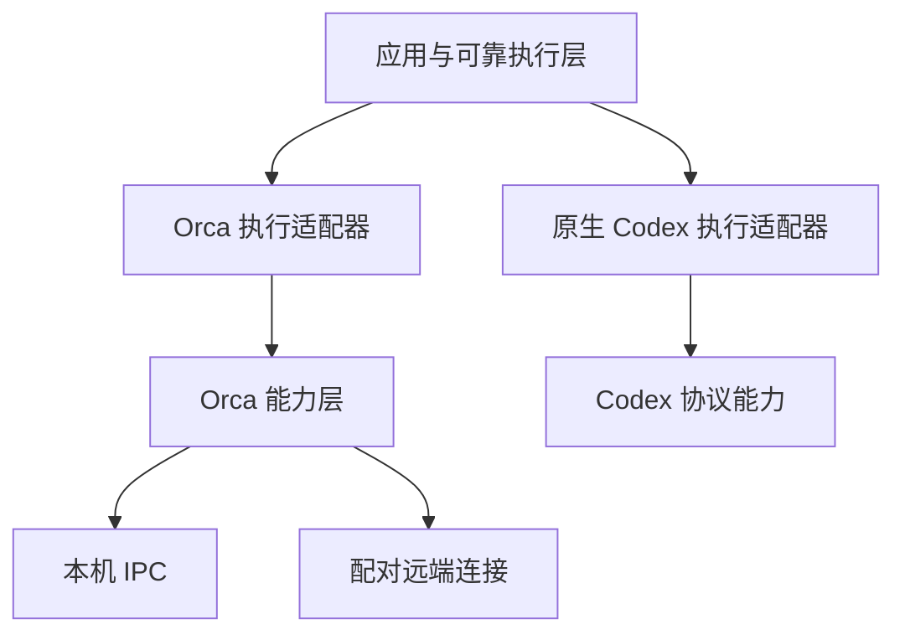

# Orca 能力层长期设计

> 2026-11-03 后继最小 PR（已实施，资格见实施记录）：[结构化会话 Spec](../archive/2026-11/implementation/spec/orca-structured-agent-session.spec.md) / [Plan](../archive/2026-11/implementation/spec/orca-structured-agent-session.plan.md) 仅迁本机 Codex 新 execute/1；停止缺证据明确未核实，同时移除 DSH 执行和专用历史/用量支持。不修改 Orca；其它 Codex/Pi、terminal 与非 Orca 保持，完整迁移/旧 helper 退役留后续。B0–B6 结论和历史证据不重写，新方案不继承其资格。

维护日期：2026-11-03。设计核对基线：`efa871cfffb950505bf2f0a325ec7751fb4be7f3`。

状态：B0、B1、B2a–B2d、B3 已完成并通过实施后独立审计；B4a 已完成并通过独立审计；B4b 已完成并通过独立审计；B4c 已完成并通过独立审计；B4d 已完成，独立审计唯一 P2 已修复并关闭；B5 已完成，最终同构建四场真实资格和独立审计均通过；B6 已完成，最终同构建四场资格及归档独立审计通过；B0–B6 全部签收，保留例外和资格边界仍按当前合同逐项表达。本文持续维护，不随某一批实施结束归档。当前运行行为、支持组合及验证资格仍以生产代码、[长期产品承诺](steerrunner.spec.md#长期产品承诺)和对应验收为准。

统一交付：[SteerRunner PR #93](https://github.com/erranliu/SteerRunner/pull/93)，分支 `codex/orca-capability-layer`。各批提交、独立修复及验收分别保留；未合并或部署。

后续完整回归发现的只读usage绑定、原生夹具和目录门禁回归，以及基线工作流目录断言，已修复并通过正式完整L1/Controlled；范围和历史失败见[B6补验记录](../archive/2026-11/implementation/acceptance/orca-native-rollout.md#2026-11-03-pr-93-完整回归修复)。原现场资格仍绑定其原构建。

## 1. 设计目标与范围

以 Orca 这个外部系统为能力边界，提供可脱离执行链使用的连接、资源操作、终端操作、状态与会话读取、文件操作。执行链消费这些能力，负责业务流程、操作授权、持久化及证据判定。

采用“抽出能力、接入两端、删除旧实现”的方式，同时推进结构解耦与本机/远端链路收敛。最终由同一个 Orca 执行适配器组合公共能力，目标位置主要决定连接和资源选择，只保留有明确依据的少量流程差异。不能把两套 Lifecycle 各自包装成接口后当作统一完成。

本设计覆盖 Runner 经本机 Orca 和配对远端 Orca 的路径。独立的原生 Codex adapter 不在实施范围，但设计必须允许其通过自己的协议能力接入执行框架，不依赖 Orca 包。Orca 内运行的 Codex、Pi、DSH 仍属于 Orca 消费方需要处理的 Agent 适配。

现有 Orca 协议是实现依据，不为本设计修改 Orca、增加 SSH 网关、部署 helper 或构建完整 Orca SDK。仅抽取已有实际消费者需要的能力。

## 2. 初始结构与收敛结果

| 位置 | 能力 | B1–B6 收敛结果 |
| --- | --- | --- |
| [protocol/orca/state_transport.go](../../internal/execution/adapters/protocol/orca/state_transport.go)、state_local.go、state_stream.go | 本机 IPC、远端配对连接、统一请求响应 | 保留明确主机连接差异；公共调用构造/解码及路由由能力层提供 |
| [protocol/orca/state_feed.go](../../internal/execution/adapters/protocol/orca/state_feed.go)、state_query_feed.go | 快照、通知和独立查询，区分样本来源 | 原生读取及样本来源自有类型；Run/输入/完成判定留在 adapter |
| [protocol/orca/terminal_query.go](../../internal/execution/adapters/protocol/orca/terminal_query.go) | 原终端查询及身份核对 | 自有 TerminalIdentity，无执行层导入；业务/控制等实际消费者共用 |
| [protocol/orca/scoped_files.go](../../internal/execution/adapters/protocol/orca/scoped_files.go)、[orcatransport/artifact.go](../../internal/execution/adapters/orcatransport/artifact.go) | 选定主机上的有界文件操作 | 能力层只管明确 scope/限额；Run/staging 路径、用途、预算由消费者持有 |
| [orcatransport/creation_owner.go](../../internal/execution/adapters/orcatransport/creation_owner.go) | 冻结创建命令、首次派发及原回执对账 | owner 保留原操作/首次派发/未知对账，消费公共资源创建构造和解码 |
| [orcatransport/lifecycle.go](../../internal/execution/adapters/orcatransport/lifecycle.go) 及控制、history、停止实现 | 双端业务接线和现有证明链 | 选定 Codex/development 原生合同双端共用；仍有 managed 消费者的模型/审计/停止例外单列 |

`protocol/orca` 是能力层的实施起点。初始基线仍引用执行类型；B1–B4d 已逐项迁移并删除原执行依赖，当前生产文件不导入其他 internal 所有者。职责和真实消费者的验证仍按各批验收，不以目录、文件数或接口数签收。

## 3. 目标依赖方向与状态所有权

上图表示调用关系，具体 adapter 由 application/组装入口接线，reliable 继续只依赖窄端口，不直接导入 Orca 或具体 adapter。图中省略 Orca 能力层内部按操作使用的 CLI/RPC。CLI 经本机启动也可以明确路由到远端，不能把 CLI 等同于本机执行，或把 RPC 等同于远端执行。

| 所有者 | 负责 | 不负责 |
| --- | --- | --- |
| Workflow / application | 步骤、材料、模型角色、业务输入、审计及发布条件、事务提交与公开投影 | Orca envelope 解码、CLI 参数拼装、连接协议 |
| reliable / operation | 原操作身份、派发资格、撤销、未知操作对账及预算规则 | Orca 方法、目标发现及原生字段解释 |
| Orca 执行适配器 / 原 execution owner | 执行模型映射、能力调用顺序、Run 绑定、原生事实的来源核验、完成与停止合同、原有持久回执 | 重复实现 Orca 连接、操作编译及协议解码 |
| Orca 能力层 | 明确目标上的原生操作、资源身份校验、协议结果和有界读取 | Run/Workflow 状态、DB、下一业务步骤、重派授权、任务成功判断 |
| 连接和 CLI 执行基础 | 认证、分帧、加密、取消、关闭、原有 CLI 串行锁及实际一次调用 | Agent 业务输入选择、完成判定、自动改换目标 |

最终 Orca 能力包不导入 application、runstate、storage、workflow、reliable、execution/backend 或 Codex adapter。使用自身的 Orca 值类型表达目标、runtime、worktree、terminal、incarnation、原生 request 和 observation；执行适配器在边界完成映射。必要的 CLI 执行依赖使用窄参数/返回值或调用函数，不接受整个 ProcessHost、LifecycleSetup 或 Run。

连接、订阅及取消句柄归能力层管理；Run 授权、业务游标、operation journal、creation owner 持久文件及资源所有权仍归原执行机制。不能为能力层建立第二套任务状态机、恢复账本或资源所有权数据库。

## 4. Orca 能力边界

| 能力 | 输入与返回的范围 | 消费方继续承担 |
| --- | --- | --- |
| 目标连接 | 明确的本机/环境目标、预期 runtime；连接或协议错误 | 冻结目标、配置与 Run 的对应关系 |
| 仓库与 worktree | 原生列表、selector、创建参数、查询结果及创建回执 | 项目选择、分支/基线要求、创建意图及未知结果处理 |
| Terminal | 创建、查询、send/read/wait/close；原 request、身份、接受阶段、cursor 和关闭事实 | 发送资格、冻结正文、回合归属、操作持久化、停止范围 |
| 状态观察 | initial/query/notification、原生 authority/revision、接收时间、完整性和断线事实 | 哪个样本足以证明原输入开始、结束或冲突 |
| 原生会话读取 | 经 Orca API 返回的消息、分页及完整性信息 | 原输入唯一性、冻结摘要匹配、原 turn/final 的业务证据 |
| 文件 | 明确原主机/worktree/路径范围内的读写、分块和完整性信息 | Run 用途、允许目录、材料/进度/结果解释及总预算 |

目标及资源类型以 Orca 原生身份命名，避免使用“worker”“Run 完成”等链路语义。方法围绕实际操作建立，不要求所有消费者实现大而全的 Runtime 接口。只有需要替换实现或已有多个消费者的边界才增加窄接口。

能力层可以返回“请求已接受”“原终端已退出”“原生代理状态为 done”；任务 Started、Succeeded、resources_settled 由原执行合同判定。查询结果不能被包装成通知，传输成功不能升级为全文消费、业务开始或工作流完成。

Agent 的提示词包装、输入预算、逻辑正文规范化、Codex 终端编码、模型策略、managed helper、history 证明、工作区审计及停止 scope 不属于 Orca 协议。它们保留在有实际消费者的 Agent/执行职责中；确需跨 adapter 复用时，再提取不依赖 Orca 的小组件。不能让原生 Codex adapter 为复用正文处理或摘要计算而导入 Orca 能力包。

### 4.1 命令构造与一次调用

普通调用和 creation owner 共用目标路由、参数编译、环境屏蔽、envelope 解码及原生错误表达。创建流程可组合纯命令编译、一次执行和回执解码；命令冻结、摘要、原文件编码及首次执行资格仍归 owner。

排队、超时、取消和原 CLI 锁沿现有语义。确需在取得队列后、实际派发前持久化时，由消费方提供窄的一次性派发前回调；能力层不理解回调中的 Run、DB 或 operation，也不据此产生重发资格。排队期间未调用与可能已产生副作用必须可区分。

原生 request ID 或 `--retry-request` 不等于允许自动重发。创建、send、close 结果未知时返回原有不确定事实，交由消费方按原操作对账；不自动换 ID、换资源、换目标或从 RPC 回退 CLI 再执行。原准备读取的白名单重试继续由现有预算所有者控制，迁移时不增加通用自动重试器。

### 4.2 身份、来源与边界信息

调用始终使用明确目标及原资源身份。Orca 连接目标和 RPC 执行主机字段是不同概念：远端连接上的 `executionHostId=local` 可以表示该 Orca 的本地主机，不能改写为 Runner 本机。

保留 runtime/terminal/incarnation、worktree/pane/provider、authority/revision、分页完整性、截断和上下文期限等原生信息。能力层的资源核验不替代执行层的 Run/Attempt/command/input 绑定，也不能把原生 transcript 路径当作调用端可直接打开的文件。

错误及诊断不包含 token、配对凭据、完整用户正文或环境。新包内部错误映射回现有对外错误时保留身份冲突、连接故障和结果未知的区别；不借抽象另建公开错误或配置体系。

### 4.3 最小职责迁移表

类型和导入独立只是必要条件。即使 Run ID 被写成 string、规则不导入执行包，按 Run 拼路径、认领原输入或判定业务完成仍属于执行策略。各批 Plan 至少细化下列对应关系，明确迁入能力、保留策略、消费者和旧实现删除位置。

| 当前职责及位置 | 能力层保留或抽出的原生操作 | 执行或 Agent 消费方保留的策略 | 实际消费者与删除要求 | 批次 |
| --- | --- | --- | --- | --- |
| terminal_query.go、Lifecycle.original、controlLines | 指定目标的 terminal.show、runtime/terminal/incarnation 核验及有界取消 | Run 对应关系、业务 agent/worktree/branch、初始化阶段例外 | 业务终端与控制终端共用查询，删除控制流前后专属 CLI show | B1 |
| Lifecycle CLI 闭包、creation_owner.go | 明确目标的命令编译、环境屏蔽、一次调用及 envelope 解码 | 冻结命令、派发前落盘、原操作资格及创建结果对账 | 日常调用和 creation owner 共用构造，删除两处重复路由/解码，不改原持久编码 | B2a、B4b |
| native_input.go 的 QueryNativeInput | nativeChat.readSession 的有界分页、消息及完整性信息，保留读取上下文 | 冻结基线后的唯一原用户输入、重复/改变正文拒绝、摘要和回合归属 | 本机/远端原生输入取证共用读取；唯一性规则移至执行侧，删除协议包内的专属认领算法 | B3 |
| native_input_query.go、QueryOriginalInput | 原终端、pane/provider 和状态的查询、身份事实 | 前后围栏的组合、thin/corroborated 适用性、原 done 与输入对应关系 | 原生取证组合公共查询；原瞬态查询证明和防冒认规则随策略迁移，不把证明字段暴露为可从 wire 注入 | B3 |
| protocol/orca/progress.go、orcatransport/progress.go | 明确主机/worktree/相对路径范围的读写、分块、元数据及完整性信息 | Run ID 校验、.steerrunner/progress 与 result 路径生成、初始化时机、用途和业务限额 | progress/result 共用受限文件能力；删除能力层按 run 拼路径及 result 布尔值选择用途的实现 | B4c |
| artifact.go 的 staging 上传 | 目标与范围明确的分块写入、原生回执 | .sr-runtime-stage 允许范围、原 Run/资源绑定及上传用途 | 安装材料/停止请求等现有调用方明确提供约束；删除底层硬编码用途，保留同等范围检查 | B4c |
| stopped.go、native_stop.go、local_codex_stop.go | 原终端关闭及完整原主机清单、终端身份和退出/缺席事实 | 需要结算哪些对象、helper/根进程事实、stop scope 与 resources_settled | 双端停止和只读核验消费公共操作；删除重复协议处理，现行 scope 在 B6 前保持 | B4d |

上述读取能力不等于不受限的通用访问。消费方提供明确资源、路径、读取限额和原期限；能力层校验原生身份、路径范围及协议完整性，不能因职责迁移扩大可访问范围。业务限额迁出时仍以显式约束传入，不变成无限读取。

迁移验收同时覆盖两端：原生会话读取可以完整返回多条用户消息，执行侧仍须拒绝将重复/外来输入认领为原业务；文件能力可以操作约束内的普通相对路径，执行侧继续生成和校验原 Run 的 progress/result 路径。不能通过“无执行包导入”“不需要 Snapshot”单独签收，也不能让每条链各复制一份迁出的策略。

## 5. 双端收敛规则

**OCL-01 能力独立。** 能力测试可以用协议夹具和 Orca 身份值运行，不需要构造 Run、Workflow 或 LifecycleSnapshot。接口和行为也不解释 Run ID、Workflow 步骤、业务路径约定或原输入归属；按 §4.3 验证语义边界。

**OCL-02 单一实现。** 每抽出一项真实共用能力，同批接入可用消费者并删除对应旧实现。未迁模块可继续存在，但不能双写协议或形成长期自动回退；批次记录剩余调用位置。

**OCL-03 薄执行适配。** 双端使用同一个 Orca adapter。位置差异集中在目标/连接和原生资源解析；执行合同的差异按事实声明，不能散落为“本机就可信”“远端就无需核验”的隐含判断。

**OCL-04 事实不增权。** 公共能力保留来源与身份，执行层继续核验原业务证据。不能用统一的 done/成功布尔值消除 history、独立查询和连续通知的证明条件。

**OCL-05 迁移有删除。** 先迁职责、接入消费者，再评估是否拆包。迁移期间按已完成能力检查依赖，最终能力包无执行层和 Codex adapter 导入；不为即将退役的 helper 建长期插件框架。

**OCL-06 合同调整显式。** 结构迁移不自动减少能力或放宽停止。确需统一合同的批次须同步修改产品承诺、准入、能力报告、公开说明和验证。

当前必须保留的差异包括 IPC/配对认证、查询/订阅可用性、仓库 selector 解析，以及尚未统一的 Agent 证明和停止合同。后两类是待收敛对象，不是永久保留两套执行引擎的理由。能力选择只使用冻结配置和真实已核验能力，不因缺字段、断线或证据缺失切换成更宽松路径。

## 6. 分批实施路线

各批先写对应的小范围实施 Plan，列实际改动、§4.3 职责映射、消费者、删除清单和验证入口，再改代码。实施状态逐批记录。B2、B4 是主题分组，按表中子批次独立交付，不将其全部操作打成一个实施任务。

| 批次 | 状态 | 抽象与接入 | 同批收敛收益 | 完成条件 |
| --- | --- | --- | --- | --- |
| B0 原生可行性核验 | 已完成 | [Spec](../archive/2026-11/implementation/spec/orca-native-capability-baseline.spec.md) / [Plan](../archive/2026-11/implementation/spec/orca-native-capability-baseline.plan.md) / [验收](../archive/2026-11/implementation/acceptance/orca-native-capability-baseline.md)；双端无 helper 的两轮原输入、完整 final、同会话后续及原终端清理通过 | 取得共同底层能力及合同差距，生产不变 | 独立审计完成，未知创建记录缺口已修复；不签收开发业务资格 |
| B1 原终端查询 | 已完成 | [Spec](../archive/2026-11/implementation/spec/orca-terminal-query-capability.spec.md) / [Plan](../archive/2026-11/implementation/spec/orca-terminal-query-capability.plan.md) / [验收](../archive/2026-11/implementation/acceptance/orca-terminal-query-capability.md)；使用 Orca 身份/结果类型，业务终端及本机控制终端共用查询入口 | 控制每页两次 CLI show 已删除，原身份围栏保持 | 双端无模型查询、受控分页/替换/取消及原回归通过；独立审计通过 |
| B2a 公共命令构造 | 已完成 | [Spec](../archive/2026-11/implementation/spec/orca-cli-construction-capability.spec.md) / [Plan](../archive/2026-11/implementation/spec/orca-cli-construction-capability.plan.md) / [验收](../archive/2026-11/implementation/acceptance/orca-cli-construction-capability.md)；共用路由、环境屏蔽、参数编译和基础 envelope 解码，接入日常调用及 creation owner 的对应构造/校验 | 三处专属拼接及 owner 专属基础结果解码已删除，原命令和创建计划编码保持 | 旧命令字节/摘要、唯一派发、回调及定向回归通过；独立审计通过 |
| B2b Terminal 发送 | 已完成 | [Spec](../archive/2026-11/implementation/spec/orca-terminal-send-capability.spec.md) / [Plan](../archive/2026-11/implementation/spec/orca-terminal-send-capability.plan.md) / [验收](../archive/2026-11/implementation/acceptance/orca-terminal-send-capability.md)；业务/agent-start/control 共用原生发送 | 三处对应命令/身份解码重复已删除，正文与阶段意义仍属消费方 | 原参数、接受/开始区别、字段范围及未知恢复验证通过；独立审计通过 |
| B2c Terminal 读取 | 已完成 | [Spec](../archive/2026-11/implementation/spec/orca-terminal-read-capability.spec.md) / [Plan](../archive/2026-11/implementation/spec/orca-terminal-read-capability.plan.md) / [验收](../archive/2026-11/implementation/acceptance/orca-terminal-read-capability.md)；readiness/control 共用单页 read | 两处参数/结构重复已删除，原字段范围、窗口及回执用途保持 | cursor、完整行、取消、分页身份围栏及原消费者回归通过；独立审计通过 |
| B2d Terminal 等待 | 已完成 | [Spec](../archive/2026-11/implementation/spec/orca-terminal-wait-capability.spec.md) / [Plan](../archive/2026-11/implementation/spec/orca-terminal-wait-capability.plan.md) / [验收](../archive/2026-11/implementation/acceptance/orca-terminal-wait-capability.md)；原双端 composer 共用原生 wait | 唯一旧 wait 参数/结构已删除，等待不承担业务完成证明 | 原参数/期限、前后身份及负面等待/取消/原输入回归通过；独立审计通过 |
| B3 状态与会话读取 | 已完成 | [Spec](../archive/2026-11/implementation/spec/orca-state-session-capability.spec.md) / [Plan](../archive/2026-11/implementation/spec/orca-state-session-capability.plan.md) / [验收](../archive/2026-11/implementation/acceptance/orca-state-session-capability.md)；原生消息/状态与执行认领分离，双端接入一份策略 | 协议状态已移除执行身份/原输入证明，原策略迁至执行侧 | 多用户原样读取、错误归属拒绝、原围栏/来源及两包全集通过；独立审计通过 |
| B4a 仓库与工作区查询 | 已完成 | [Spec](../archive/2026-11/implementation/spec/orca-resource-query-capability.spec.md) / [Plan](../archive/2026-11/implementation/spec/orca-resource-query-capability.plan.md) / [验收](../archive/2026-11/implementation/acceptance/orca-resource-query-capability.md)；共用实际 repo list/worktree show 原生查询 | 目标 selector 选择留给消费方，删除对应查询/解析 | 原主机、仓库身份、基线和歧义拒绝保持 |
| B4b 资源创建 | 已完成 | [Spec](../archive/2026-11/implementation/spec/orca-resource-create-capability.spec.md) / [Plan](../archive/2026-11/implementation/spec/orca-resource-create-capability.plan.md) / [验收](../archive/2026-11/implementation/acceptance/orca-resource-create-capability.md)；组合 B2a 与 worktree/terminal 创建、回执操作，接入原 creation owner | 原 owner 保留首次资格及对账，删除创建专属协议拼装/解析 | 未知零重发，原命令/摘要/编码及资源归属保持 |
| B4c 受限文件操作 | 已完成 | [Spec](../archive/2026-11/implementation/spec/orca-scoped-files-capability.spec.md) / [Plan](../archive/2026-11/implementation/spec/orca-scoped-files-capability.plan.md) / [验收](../archive/2026-11/implementation/acceptance/orca-scoped-files-capability.md)；按 §4.3 分离原生文件能力、Run 路径生成及用途策略 | progress/result/staging 消费公共读写，能力层不解释 Run | 路径范围、原主机、分块、限额和完整性保持；业务路径/限额由消费方显式提供 |
| B4d 关闭与完整清单 | 已完成 | [Spec](../archive/2026-11/implementation/spec/orca-close-inventory-capability.spec.md) / [Plan](../archive/2026-11/implementation/spec/orca-close-inventory-capability.plan.md) / [验收](../archive/2026-11/implementation/acceptance/orca-close-inventory-capability.md)；共用原终端 close 和完整清单读取，接入双端停止/只读核验 | 删除重复协议处理，停止合同仍归执行层；完成能力包依赖与语义检查 | 关闭未知零重发、原 incarnation/host 范围保持，不扩大当前 stop scope |
| B5 候选生产接线与业务资格 | 已完成，独立审计通过 | [Spec](../archive/2026-11/implementation/spec/orca-shared-native-runner.spec.md) / [Plan](../archive/2026-11/implementation/spec/orca-shared-native-runner.plan.md)；实现选定组合的完整候选生产接线，在隔离 Runner 构建/状态目录中经真实入口验证双端开发、持久结果和停止结算| 为 B6 提供已实现、可受理并可完整结算的新 Run 路径 | 按 §6.2–§6.3 通过真实 Runner 受理/冻结/执行/发布/stop/离线核验、零旧链调用及停止负例；能力测试装配不单独签收 |
| B6 最终启用并退役旧链 | 已完成，独立审计通过 | [Spec](../archive/2026-11/implementation/spec/orca-native-rollout.spec.md) / [Plan](../archive/2026-11/implementation/spec/orca-native-rollout.plan.md) / [验收](../archive/2026-11/implementation/acceptance/orca-native-rollout.md)；公开合同与保留消费者同步，删除不可达重复 guard | 两端只留连接、目标解析及确有必要的轻流程差异 | 最终构建复验受删除/启用影响的真实 Runner 资格与停止负例；原升级/旧记录规则保持，不首次补齐 B5 所需接线 |

B0 无能力层重构前置，复用当前真实 Orca 协议即可。B1 和 B2a 有独立收益，可在 B0 未结束时先行；B3 必须先有 B0 对拟统一组合的可行性与差距结论，不能先完成复杂取证抽离再验证方向。B0 失败或环境阻断时，相关统一目标保持待核验，先明确范围/设计调整，不自动回退 helper 取得“原生通过”。

B2b–B2d 消费 B2a 的构造结果，分别迁入实际操作；B4b 依赖 B2a，不重写 creation owner 的可靠性机制。B5 在所需能力已接入后，先实现候选生产接线，再验收其业务资格；B6 以对应组合的 B5 实现和验收通过为前置，不以尚未实现的 B6 接线反过来满足 B5。本机、远端及不同 Agent/Workflow 的资格不互相替代。B1 的查询变化只涉及活动业务/控制终端，停止、创建对账及离线核验不顺带改调用方式。

此前讨论的正文编译统一可以单独安排为 Agent 输入层的小批次，不塞入 Orca 能力包，也不作为 B1 的前置。

### 6.1 B0 的可行性证据与零旧链调用

首轮以经 Orca 运行的 Codex 为共同 Agent，独立原生 Codex adapter 不参加。固定本机和远端各自的 runtime/原 worktree/新 terminal/incarnation/session，在隔离测试资源上验证一次原输入、一次当前会话内后续输入、每次完整原生 final，以及原终端关闭和完整清单。每次发送沿原请求执行一次；未知只对账，不补发。B0 不创建开发 PR、不运行完整业务 Workflow。

以下条件同时适用于 B0、B5 及 B6 的对应资格，证据按目标和原资源分别记录：

- 实际 managed helper 启动数、native-control 终端创建数、旧 control actor 的 original-turn 请求数均为零；不调用 recorded-history reader，不以 RemoteTurnReceipt/Recorded 结果取得业务完成。
- 保存实际启动命令、资源创建和原生调用计数、原请求/输入摘要、结果来源及原资源清理事实。检查范围为本轮调用和拥有的资源，不扫描或停止共享 Orca/无关进程；模型自述或仅有 `completed=true` 不构成证据。
- started/completed/final 使用拟统一的原输入、新 done 和完整原生 final 规则；经 Orca 的 nativeChat.readSession 是允许的原生读取，不能与禁止的 managed recorded-history reader 混为一类。
- 原生探针只证明拟采用的原终端停止范围及精确清理，不将其结论冒称当前 `orca_local_codex_resources` 的全部对象已结算。B5 候选合同须在真实 Runner 中冻结并按该范围结算；已部署版本的停止合同在 B6 启用前保持。

当前 `runLocalNativeInputProbe` / `validateLocalProbeTarget` 明确要求 helper/control/history。它们继续作为旧链回归，原样通过不能签收 B0 或 B5。可在现有测试框架中扩展隔离的无 helper 原生接线和调用记录，不引入生产调试开关，不伪造 readiness、Started、done 或原生输入证明。

B0 输出“原生已证能力、与当前合同的差距、未验证项”清单，分别列输入/结果、实际模型、工作区审计、Git/发布和停止范围。短会话只能证明其覆盖的底层可行性，不能据此删除开发执行机制。

### 6.2 B5 的候选生产接线和真实 Runner 验收

B5 先实现候选接线，再执行验收。实现范围包括选定组合的新 Run 准入、配置与材料冻结、profile/资源身份及 codec 映射、启动准备、输入/结果取证、stop scope 冻结、在线停止、持久结果投影和离线 verify-stopped。不能只在测试里直接组合 Orca 操作，再把正式入口、冻结和停止适配留到 B6。

B5 的实施 Plan 在编码前明确拟支持的 Agent/Workflow/目标组合、候选停止合同以及必要的配置/格式处理，并在隔离候选构建和独立状态目录中启用整套候选接线。若准入、私有 codec 或支持范围需要变化，应在本批显式设计和验证，不伪装成纯结构迁移；不更改已部署实例、共享状态目录和其他组合，也不增加长期生产调试开关或测试专用后端。

B5 的业务资格必须从真实 Runner CLI/API 受理新请求，经正式冻结、Engine/reliable/Orca adapter 和持久化机制执行。测试 driver 只能提交正式命令、读取公开结果、提供隔离环境和记录调用；能力测试装配、直接调用 Lifecycle/Orca 方法或手工生成 Snapshot/Run 记录不能单独签收。受控故障测试可以替换外部 Orca 响应，但仍须覆盖候选接线的真实执行与结算机制。

B5 首轮针对两端的 `development/2` 候选组合，在独立测试仓库/工作区分别运行真实开发案例：核验仓库和固定 base，生成最小修改并测试，通过原执行主机工具完成 commit/push/测试 PR。程序独立核对 repository、branch、base/head、精确提交 SHA 和 PR 身份；模型自述、一个 final 或只读 nonce 任务不能替代。

案例同时覆盖启动、业务输入、当前 Workflow 允许阶段的同会话反馈、完整 final、停止及完整原资源清单；反馈安排在允许输入且尚未进入 pr_ready 的阶段，不恢复已经退役的发布后反馈。每个目标使用新会话和独立证据，按 §6.1 核对零旧链调用。发布结果未知仍只对账；不合并测试 PR，不修改业务仓库。业务结论、发布核验和资源收尾分别记录，清理未知不记为资格通过。

双端成功案例均须保留可关联的正式受理回执、Run/请求/原资源身份、冻结配置及停止 scope、Workflow/PR 核验、在线 stop 结果和持久结果读取。显式 Run stop 完成后，经正常 service stop 退出 writer，再用真实 `service verify-stopped` 离线只读核验同一状态目录，确认资源范围和结算一致；不能用一个测试函数返回成功替代。离线核验不启动 Engine/模型、不建资源、不补写 stopped，也不以 service stop 代替 Run stop。

B6 在 B5 已实现的同一候选生产接线上完成最终启用、产品合同与 capabilities/公开说明同步、无消费者旧链删除及升级排空检查，不首次实现已被 B5 宣称验证的新 Run 受理或停止路径。删除、配置启用或编码变化影响接线时，须用最终构建复验对应真实 Runner 闭环及 §6.3；仅在源码、构建及相关接线一致时复用已有证据，不能将旧构建结果平移。

B0、B5 和 B6 分别签收底层可行性、候选生产实现与真实业务资格、最终启用及退役旧链。当前本机 managed 的 history、实际模型及工作区审计证明，不能推定原生链路具备；远端当前 scope 为 `orca_terminal`，本机受管 Codex 为 `orca_local_codex_resources`。B5 对每个拟切换组合明确继续支持、通过 Orca 能力补齐或收缩的项目，并按该候选合同实现和验收；B6 只启用已取得资格的组合，不能静默放宽 audited 或停止判据。未取得资格的组合不计为统一完成；保留的例外须列明原因和剩余实现，不以迁移包装掩盖第二条执行链。Pi/DSH 和 audited 不继承首轮 Codex/development 的资格。

生产切换必须完成准备、输入、完成、停止和收尾整个闭环。不能先接入无 helper 的执行，再把无法满足的停止/审计合同留给后续补救。旧 Run 沿现有升级排空、格式及只读规则处理，不迁移原摘要、不重释历史证据，也不为迁移保留第二套活动任务接管机制。

### 6.3 活动停止和未知关闭结果的最小验收

正常开发案例结束后的终端关闭只覆盖正常收尾。B4d 的公共关闭/清单能力需验证对应负例；B5 还必须将其接入候选原生合同，经真实执行/持久化/结算机制复验。旧 managed 或仅远端 scope 的用例可复用夹具，不能直接作为新增本机接线的通过证据。

| 场景 | 必须验证的行为 | 判定依据 |
| --- | --- | --- |
| 原业务回合活动时接受 stop | 先持久受理撤销，再执行原资源停止；之后不派发新业务输入、后继步骤、答案或反馈，不复用迟到结果恢复授权 | 正式 stop 回执、原 operation/事件顺序及实际调用计数；活动状态须由原请求/回合事实确认，不能只按固定 sleep 或模型声明安排 |
| close 已调用，外部效果可能发生但响应丢失 | 同一 stop 后续仅查原 runtime/host/worktree 的完整清单；不重发 close、不建替代资源、不补造关闭回执 | 本轮 close 实际调用为一次；原资源确已退出/缺席且清单完整时，可按候选 scope 结算；仍活跃或无法核实时保持未核实 |
| stop 已在途且回执提交失败，或后续对账重入 | 从原持久意图恢复对账，不以缺回执授权第二次关闭或新停止意图 | 原请求/operation 身份、持久记录和 close 调用计数保持；重复请求不产生新副作用 |
| 原 handle 换 incarnation、runtime/host 冲突，或清单被截断/缺 host/查询失败 | 不认领替换资源，不报告 stopped/resources_settled；保留身份冲突或未核实原因 | 候选接线的状态、诊断及原资源事实，不能仅凭已保存 stopped 标签跳过核验 |
| 已证明排队期间未实际派发 close | 与“已调用但结果未知”分别处理，仅按原操作保留首次派发资格 | 队列/派发前回调及实际调用证据；不能将任意超时解释成未派发，也不能把合法首次派发算作未知后的重发 |

以上故障由现有受控夹具用屏障/明确故障点注入，至少覆盖本机与远端候选路由；不要求为每个负例启动模型或制造真机网络故障。负例通过后，新增本机无 helper 路径至少补一例真实活动停止：经正式 Runner stop 撤销并终止原回合，核实完整原资源清单及离线 verify-stopped。远端按受影响实现复用同构建的活动停止证据，缺少等价覆盖时补对应场景，不恢复整套故障矩阵。

活动停止案例使用独立 Run、资源和证据，不与成功发布案例合并计数，也不要求被停止的业务继续发布。业务停止、资源结算与清理分别记录；环境阻断、身份错误、未知或清理未确认均不计通过。B5 完成条件同时包含 §6.2 的成功闭环和本节的停止/未知结果闭环；B6 最终变更影响这些行为时必须复验。

## 7. 每批验证与评审

验证按实际变化选取，不为结构迁移复制全平台资格矩阵。每批至少记录以下四类证据：

1. **能力测试。** 使用原协议夹具验证目标、身份、错误、半包/分页、取消及资源释放；测试不需要执行链快照。涉及有副作用的调用时核对实际调用次数及未知零重发。
2. **消费者回归。** 本机/远端使用真实构造接线；核对参数、请求身份、回执及来源映射，避免仅测新函数而旧调用仍在。受影响的 managed/Agent 分支保留对应回归。
3. **结构、语义与编码。** 按 §4.3 列迁入原生操作、保留策略、消费者、删除位置及剩余差异；同时核对依赖与接口行为。能力接口不能以字符串或布尔值暗藏 Run 路径、输入认领或 Workflow 策略，迁出的公共策略只能有一份。结构批次保持 profile/state/target hash、creation plan 和对外 schema，必要时用现有固定夹具比较原编码。
4. **真实接线。** 连接/查询改动先验证无模型原生查询，输入或取证改变再运行对应短会话。B0 另需 §6.1 无 helper 原生证据；B5 先实现候选生产接线，再经 §6.2 真实 Runner 验收和 §6.3 活动停止/未知结果验证，旧 managed 探针或能力测试装配不替代。未执行、skip、环境阻断和清理未知均不记为通过。

B1 可复用现有 `OriginalTerminalRPC`、`QueryBoundTerminal`、`FixedControlStream`/`FixedControlReceiptRecovery` 夹具；B2 各子批次按操作选取 `NativePromptSubmission`、`NativePromptReceiptFaults`、`WireBudget` 及 creation owner 回归；B3 复用原输入、native state、history、reconnect 和 final 反例，并补原生多消息读取与消费方唯一认领的分层验证。B4c 补约束内普通路径与原 Run 路径生成的分层验证。实施 Plan 固定实际测试名与命中数，避免零匹配计为通过。原夹具仍可测试执行层；“能力测试无快照依赖”不要求删除这些有效回归。

B4d/B5 的停止反例可复用 `TestRemoteStopPreservesUninvokedCloseAndCancelsObservation`、`TestTerminalStopProgressCannotCrossIncarnation`、原完整清单夹具，以及 application 的 stop/派发排序、丢回执和只读核验夹具。实施 Plan 必须标出哪些既有断言只覆盖旧合同，哪些已通过真实候选 adapter/冻结 scope/原操作执行，不能仅因测试名匹配或旧路径通过就签收新接线。

每批评审回答：能力是否能独立调用；两端是否少维护了一份实现；是否删除旧接线；是否新增隐含回退/状态；是否改变支持或证据合同。只有新增接口、旧分支全部保留的批次不能记为完成。

## 8. 文档维护与专项关系

本文维护目标结构、职责边界、OCL 规则、路线和实施状态；小批次 Plan 固定当期改动，acceptance 保存具体源码/构建/环境的结果。每批结束更新本表状态并链接证据，历史证据不重写。生产支持以完成实现和对应验收为准，长期目标不覆盖当前行为。

| 文档 | 与本文的分工 |
| --- | --- |
| [产品承诺](steerrunner.spec.md#长期产品承诺) | 能力、可靠性、停止范围及升级的长期合同；B5 明确候选变化，B6 正式启用时同步 |
| [执行边界](../archive/2026-11/implementation/spec/execution-boundary-refactor.spec.md) | 保持 Workflow → reliable → adapter 方向；本文细化 Orca 对接能力边界 |
| [本机/远端连接](../archive/2026-11/implementation/spec/orca-local-remote.spec.md) | 当前路由、认证、查询与订阅语义；结构收敛继续遵守其有效规则 |
| [远端原生](../archive/2026-11/spec/orca-remote-native.spec.md) | 当前无远端 helper 的执行和停止合同；是共享原生链路的可行基础 |
| [通用提交](../archive/2026-11/spec/orca-native-submit.spec.md) | 当前输入冻结、编译、接受/开始及原输入证明；不因抽象放宽 |
| [本机停止收敛](../archive/2026-11/implementation/spec/orca-local-codex-stop-simplification.spec.md) | 当前登记资源及 scope；B0–B4 不改当前合同，B5 候选合同单独冻结和验收，已部署合同在 B6 前保持 |
