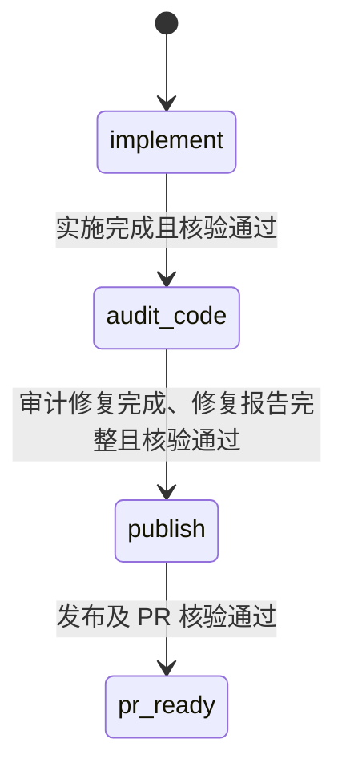
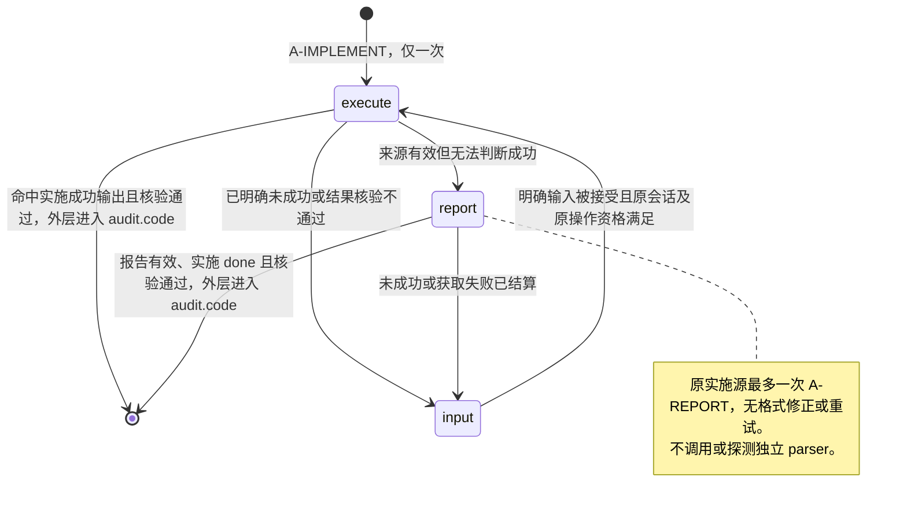
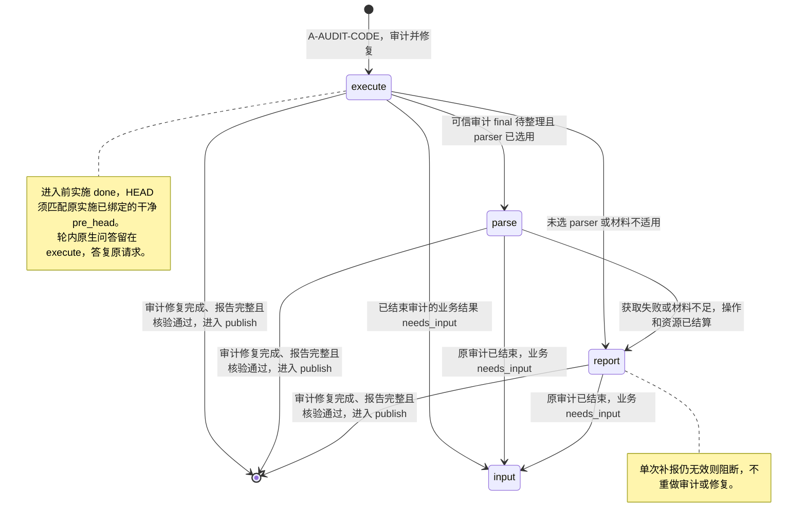
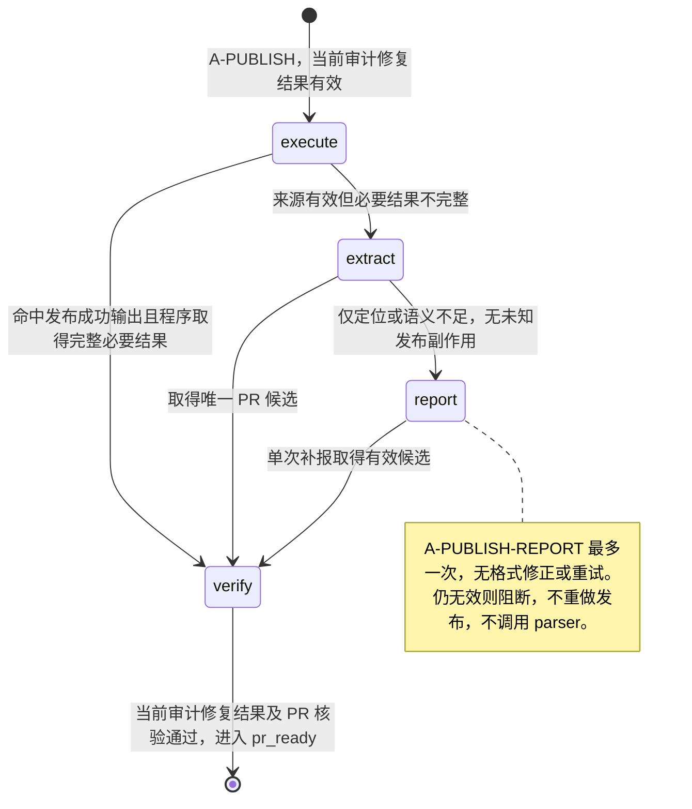
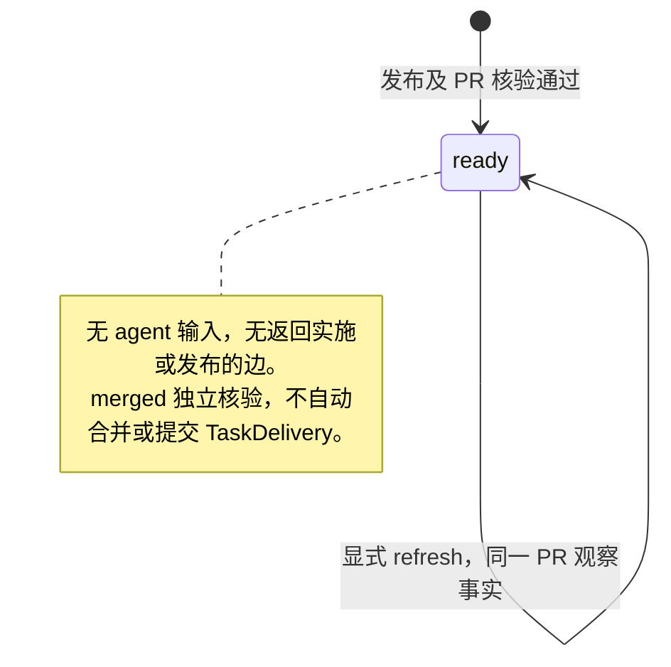

# Workflow：development-audited（确认稿）

> 实施状态（2026-10-18）：已按确认的最小边界实现并完成必要验证。原生权限、行为约定和事后检测见总 Spec §6；当前支持 Windows / Codex 0.159.2，默认关闭独立解析。实际支持范围、失败修正及最终证据见[验收登记](../acceptance/result-acquisition.md)。历史“仅设计”说明指此前设计轮次。

2026-10-21 默认提示优化：原审计结束优先给出现有审计 JSON 契约，减少额外结果获取。仅修改新 Run 的默认提示文本，原冻结提示、流程边、预算、模型与来源核验不变；没有原生 schema 强约束，非 JSON 仍沿既有后备。原生小样本和跨构建旧提示保留/新默认验证见[本轮验收](../acceptance/reliable-delivery-simplification.md)。
日期：2026-10-17（首次设计 2026-10-16）。实施前业务基线 `development-audited/1`；下文为 `development-audited/2` 定义，独立解析按总 Spec §6 的最小边界实施和验收。[统一能力与边界](README.md) · [普通开发版本](development.md) · [总 Spec](../spec/result-acquisition.spec.md)。本定义与普通开发共用统一能力，仅通过状态、边、提示词和核验加入“代码审计并修复”。

## 1. 实施前基线与本定义

实施前 `workflow/profile.go`、`route.go` 规定实施 → 固定报告 → Spec 审计 → 代码审计 → 发布；P0–P2 阻断，P3 建议，最多 2 次自动实施修复。当前审计来源硬绑定实施报告 Command/Turn。本定义按本轮要求移除 Spec 审计，并将代码审计与 P0–P2 修复合为一次正式执行，不再返回 implement 或按两次修复计数调度。来源改为当前实施统一结果及原实施，无需专门报告 Turn 才能审计。

实施和发布按 development 的思路：可信 final 命中阶段成功输出且核验通过即完成，无法判断时原 agent 最多 report 一次，不使用独立解析或格式修正。独立解析仅用于整理实际代码审计结果；不能替代真正审计或生成原审计没有作出的结论。

本流程支持本机 codex-app-server，以及配置并核验可信 helper 的 Orca local Codex。原生远端 orca_environment 不提供实际双模型来源证明，在接受前返回 unsupported_capability，不创建执行资源。Orca 在同一原生会话按冻结角色选择执行/审计模型；固定控制通道只读取原生回执和执行认证撤销，实际 model/effort 必须与该业务 Command 对应的冻结选择一致。Pi/DSH 不声明审计能力。执行模型用于实施/其补报和发布；审计模型用于正式审计修复及其补报，均在原执行会话通过提示词调用并冻结。独立 parser 使用隔离会话和 Runner 自身配置；切回实施/发布时恢复执行模型。共同 worktree 初始化及统一生命周期不在本定义重写。

## 2. Workflow 整体状态图



图中 audit_code 对应 `audit.code`。内部执行/获取/等待不展开在整体图。新实施建立新源并原子失效旧统一结果及审计资格。audit.code 内由同一正式执行完成审计、必要修复及验证；没有自动返回 implement 或另发修复/再审轮的边。无 pr_ready 返回实施、复用先前 PR 或自动合并/TaskDelivery 的边。

## 3. 阶段内部状态与核验

外层/内部图只是分组，唯一当前业务游标为 Workflow.StepID；Status/Phase、获取尝试与待发送意图的职责按[总 Spec §2.3](../spec/result-acquisition.spec.md)，不另建审计子状态权威。

以下 V-* 引用[统一规则](README.md)。所有边受原来源、当前授权、原操作和停止资格限制；冲突或未知先对账，不能通过补报或用户输入解除。

### 3.1 implement：实施



| 内部状态 | 进入动作 / 提示词 | 核验与后继 |
| --- | --- | --- |
| execute | PromptExecutionAgent / A-IMPLEMENT | V-NATIVE、V-SOURCE、RecognizeSuccessOutput、V-RESULT；命中且通过、当前实现已提交且工作区干净 → 完成 implement，进入 audit.code；无法判断 → report；明确未成功 → input |
| report | PromptExecutionAgent / A-REPORT，原会话、执行模型 | 每原实施最多一次，只整理原实施。程序解码并核验；done 且核验通过、实现已提交且干净 → audit.code；未成功或格式无效/信息不足且操作已结算 → input |
| input | 现有等待/reply 授权能力，无自动 agent 输入 | 与 development 相同，未成功可由 workflow_policy 生成通用等待说明，不强求具体问题或原因；原 outcome/获取缺口保留。明确输入与原会话资格满足才续执行，无输入持续等待 |

进入提示词就是 execute 的输入，只发一次。明确人工输入触发的新实施仍建立新源、失效旧审计；这不构成审计失败后的自动返工边。

### 3.2 audit.code：审计并修复与结果获取



代码审计内部动作、来源与正常后继如下：

| 内部动作 / 结果 | 规则 |
| --- | --- |
| execute | PromptExecutionAgent 在原会话以审计模型审计当前代码，直接修复发现的 P0–P2 并完成必要验证；默认提示要求最终给出已有审计 JSON 契约。修复是本次正式执行的业务，非解析/补报行为；不增加原生 schema 强约束，格式不足仍沿原后备 |
| 程序提取 | 原审计已经给出完整、可信、契约有效的机器结构时直接核验，无需 parse/report；这不是从自然语言猜结论 |
| parse | ParseResult / A-AUDIT-PARSE，每原审计最多一次；仅整理真实审计 final 和必要既有 artifact。parser 开启且材料满足总 Spec 大小/完整性门槛时才选择；否则直接 report。明确环境不可用也仅在已结算后后备；unknown、来源冲突或已知业务副作用不自动后备；固定命令权限内的本地 command/todo 违规在确认停止且原源仍适用后可单次补报；MCP/文件修改/未知工具事件阻断 |
| report | PromptExecutionAgent / A-AUDIT-REPORT，原会话/审计模型，每原审计最多一次；只整理指定审计修复，不重审、不修代码、不补检查。格式错误、缺结论或仍不足且已结算时阻断获取，无报告修正或再审输入 |
| 核验与正常出口 | V-NATIVE、V-SOURCE、V-RESULT、V-AUDIT；审计修复完成、必要验证有原依据、fixed_count 与 fixed_issues 一致、明确无遗留 P0–P2，且修复后工作区来源仍有效 → publish。修复过 P0–P2 不阻断已完成结果；未完成/遗留问题维持等待或阻断，不自动回 implement。解析成功本身不代表工作完成 |
| 非 done / input | 原生轮内问答留 execute，答复原请求；已结束 Turn 的业务 needs_input 才进 input，不能再投递到旧请求，也无自动 execute/implement 出边。仅补材料或技术 resume 不派新业务；用户明确授权进一步实施才沿人工反馈建立新实施源/pre_head 并失效旧资格。blocked 保留原阻断；格式/语义缺口不伪造 needs_input、修复记录或完成结论 |

#### 审计修复报告契约

- `outcome`、`summary`：实际完成情况和总结，沿统一业务/获取语义；未完成不以成功解析放行。
- `fixed_count`：本次实际修复的 P0–P2 问题总数，非负整数，等于 `fixed_issues` 条目数；同一问题不重复计数，不按修改文件数或模型调用数计数。
- `fixed_issues`：逐项记录 severity（P0/P1/P2）、问题内容、修复内容及已有位置/变更依据。原执行未明确的信息标缺失，不由 parser 补造。数量为 0 时明确报告 `0` 和空列表，不能由未提到问题推断为零。作为 done 采纳的正数代码修复还须 pre_head/post_head 的 Git tree 确有差异，同一或空提交不能支撑已完成的正数；此核验不证明每项修复正确。
- `remaining_issues`：明确说明仍未解决的 P0–P2 及原因，无遗留时为空列表；与“尚未完成审计/验证”区分，未知不等于空。P3 可作为 summary 中的建议，不计本次修复数量、不单独阻断。

上述字段在 done 时完整且有原依据；未完成可保留已知的部分修复与遗留信息、未核实字段和缺口，不伪造完整统计。保留问题原 severity，不把已修复的问题继续当成当前阻断项，也不能降低遗留问题 severity。程序核对数量/列表/来源与完成条件，不重新审代码或重跑验证，不把 agent 的“已修复”声明冒充 Runner 独立检查。

本阶段不再使用原 `verdict=pass/changes_requested + findings` 的返修判定；以修复后结果判断是否完成。外部解析或原 agent report 仅整理本次执行已有结果，不补做审计、修复或验证。

来源绑定统一引用[总 Spec §3.1](../spec/result-acquisition.spec.md)，本定义选择其中提交级完成条件：原实施 result/真实轮绑定干净 pre_head；正式审计可在同一 execute 内修复并提交，结束时核实干净 post_head（包含 pre_head，可相等）。固定 repository/worktree/branch/base，解析和补报不 commit、不更新绑定。实现未提交/入口脏先等待或阻断，不自动发提示词补 commit；正式审计结束仍脏或无法核实 post_head，也不能靠 report 声称完成。

接受结果、实际派发发布前及 provider 核验时，复用 Git owner 检查 HEAD=post_head、Dirty=false 和原来源/操作资格；审计版 PR.HeadRevision 必须等于 post_head。前置结果 ID/原源版本在输入与意图中冻结，不从最近报告挑源。原提交检查回执缺失时不以模型 SHA、reflog 或当前 HEAD 补绑；原审计 Turn 已结束即可解析/补报，不要求原 app-server 退出。发布按总 Spec 的查询前后复核和 CAS 顺序，只证明观测时点版本一致；已知补报写入即使 HEAD 恢复也不采纳。原实施 result 仍引用 pre_head，审计修复 result 额外关联 post_head，不覆盖旧事实；本次合法提交不被当成新 implement，不使自身失效。后续独立变更/新实施、迟到解析及恢复按总 Spec 处理；不建文件快照/版本服务，不将 Git 前后检查宣称为文件系统隔离。

### 3.3 publish



复用 development 的 ExtractResult、RecognizeSuccessOutput、V-PR 及原发布 owner；程序取得本次唯一 PR URL，并用 provider Query(URL) 核验 repository/base/head/PR。命中成功行仍必须核验，不能证明已发布、合并或交付。查询失败/未知副作用只对账本次原目标；错误身份、来源变化或冲突阻断。进入发布和最终核验时，审计修复结果及修复后工作区绑定必须仍有效；无按 head 反查新接口。

### 3.4 pr_ready



## 4. 提示词正文（拟议）

占位、来源冻结、注入及可信 final 末尾独立行识别沿[统一约定](README.md)。只列本定义所需提示，不要求调用方拼接；相同正文可与 development 共用内嵌资源。

| 阶段 / 输入 | 最终回复末尾独立行（逐字匹配） | 采纳前核验 |
| --- | --- | --- |
| implement / A-IMPLEMENT | 实施及必要验证已完成。 | 原实施来源及必要结果核验，实现已提交且干净；不证明已通过审计 |
| publish / A-PUBLISH | 本次发布已完成。 | 原发布资格、唯一 PR 候选、provider 身份/HeadRevision=post_head 及当前审计修复完成结果 |
| audit.code | 无 | 修复数量、逐项内容及完成情况经程序提取或独立解析/一次补报后核验；不只匹配成功行 |
| pr_ready | 无 | 无模型输入 |

### A-IMPLEMENT → implement 内部 execute

```text
读取当前 worktree 中以下路径的 Spec、Plan 和参考材料，完成实现及必要验证。
材料（worktree 内的仓库相对路径）：{{material_refs}}
用户补充（如有）：{{authorized_feedback}}
将完成的代码改动提交到当前分支。
完成实施及必要验证后，在最终回复末尾单独写一行：实施及必要验证已完成。
```

### A-REPORT → implement 内部 report

```text
根据你已有的执行上下文整理指定实施结果；只报告，不补做工作。
原实施：{{source_binding}}；材料：{{source_material_refs}}
契约：{{result_contract}}；输出结构：{{acquisition_output_schema}}
注明依据，保留已知失败、未知情况、缺失和冲突。
```

### A-AUDIT-CODE → audit.code 内部 execute

```text
审计当前代码，直接修复发现的 P0–P2 问题并完成必要验证。
实施及工作区来源：{{implementation_binding}}；实施结果：{{verified_implementation_result}}
材料（worktree 内的仓库相对路径）：{{material_refs}}
验证后将最终代码改动追加提交到当前分支；无改动时沿用当前提交。
报告实际修复的 P0–P2 总数及逐项问题、修复内容；未修复问题和未完成事项如实说明。
最终回复必须为单一 JSON 对象，不添加代码围栏或额外正文。
```

默认文本随后附现有 `ResultInstruction("audit")` 的完整契约：outcome/summary、实际 fixed_count/fixed_issues/remaining_issues、未完成时的问题或 blocker。只有明确知道零修复时才写 0 和空列表；JSON 合法不替代原生、Git、业务与 PR 核验。自定义 audit.code 覆盖和旧 Run 的冻结文本仍按原值使用。

### A-AUDIT-PARSE → audit.code 内部 parse（仅独立解析会话）

```text
整理以下已有审计修复结果，按契约和输出结构返回；不补做工作。
审计来源：{{audit_source_binding}}；材料：{{bounded_source_bundle}}
契约：{{result_contract}}；输出结构：{{acquisition_output_schema}}
保留实际修复数量、逐项内容及遗留问题；缺失、歧义、冲突如实标注，不补造修复或完成结论。
```

原生权限由 Codex 执行，统一 parser owner 管理冻结输入、独立资源和工具事件拒收；提示词只约定整理行为，不承诺提前拦截或零隐式上下文。包内绑定真实原审计及所审实施结果，不把实施 final 当审计结论。

### A-AUDIT-REPORT → audit.code 内部 report

```text
根据已有上下文整理指定审计修复结果；只报告，不重审、修代码或补检查。
原审计及实施来源：{{audit_source_binding}}；材料：{{source_material_refs}}
契约：{{result_contract}}；输出结构：{{acquisition_output_schema}}
保留实际修复数量、逐项内容及遗留问题，缺失、歧义、冲突如实标注。
```

### A-PUBLISH → publish 内部 execute

```text
将已完成审计修复的当前分支 push 到发布目标并创建 PR。
实施及审计修复事实：{{verified_implementation_and_audit}}；发布目标：{{publication_binding}}
用 git branch --show-current 取得实际分支，作为远端分支和 PR head。
结果未知时说明情况，不重复创建。
成功后给出 PR URL，并在最终回复末尾单独写一行：本次发布已完成。
```

### A-PUBLISH-REPORT → publish 内部 report

```text
根据已有上下文整理指定发布的结果和 PR URL；只报告，不重新发布。
原发布：{{source_binding}}；发布事实：{{publication_facts}}
契约：{{result_contract}}；输出结构：{{acquisition_output_schema}}
注明依据，保留已知失败、未知情况、缺失和冲突。
```

## 5. 审计修复、恢复及预算

Runner 对当前源只发一次正式审计修复输入，工作在这次 execute 内由 agent 完成；不另发修复提示词，不使用 RepairCount/两次自动修复上限或 audit_repair_limit，不建立自动返工/再审回路。实际修复的问题数量属于业务报告，独立于调用预算。未完成或遗留 P0–P2 时，保留真实原因并等待/阻断；只有明确用户指示可另行授权业务输入，技术 resume 不授权重做。

每原实施（含明确人工续执行）最多 1 次实施 report；每原审计最多 1 次独立 parse 和 1 次原 agent report；每次原发布最多 1 次发布 report。全部无格式修正或报告重试。完整可信机器审计结果直接核验；普通实施/发布命中成功行且核验通过也零额外获取模型调用。只有审计获取可探测/启动 parser；其他阶段即使 parser 已开启也不依赖其环境。解析关闭、不适用或明确不可用时采用预算内审计补报，不能绕过真正审计或放宽结论核验。

原执行、审计及补报 final 原样保留，解析候选单列并绑定真实审计和当前实施源。新实施原子失效旧获取资格及审计完成资格；迟到解析不能推进新源。原外层/内部进度、操作意图和预算均在现 Run/Record/Commit 管理，不建立第二套权威。兼容服务重启保留原授权和等待状态，补收原 owner/parser 事实后，可自动接续已证明未发送的后继及具备资格的获取意图；原 in_flight/未知动作仅对账。重启、resume、补读不重置次数、不重发已尝试提示词或重启未知 parser。需要显式恢复时，只续原授权范围，不默认实施或重审。详见[当前换代契约](../spec/service-generation-recovery.spec.md)。

stop、服务换代、未知操作优先于所有边，所有 executor/parser owned 资源纳入原停止核验。可信 final 缺失先原来源补读，原生失败/冲突不通过解析或补报解除。实施 input 的用户输入不能越过原会话/原操作资格；审计原生问答仍承接原请求。本次发布产生的 PR 可独立绑定、核验、刷新 merged，不因此越过当前审计或提交 TaskDelivery。

所有核验复用内置函数和原 owner，本期无定制脚本端口/宿主或通用快照设施。Runner 独立管理 parser 配置、认证引用和资源；执行/审计/parser 模型分别选择。SteerLine 不增加配置覆盖或调用义务。实际支持范围及验证结果见总 Spec §6 与专属验收，不宣称空工具面或零隐式上下文。

原生远端 Orca 不提供该流程需要的实际模型与 Git 来源证明，接受前返回 unsupported_capability；本机 codex-app-server 与 Orca local 受管 Codex 继续沿原模型切换及原工作树 owner 核验，不调用远端 helper。

## 当前实现映射

确定性 extract 采用 development 的同次提交映射。代码审计只有一个真正执行输入；完整机器结果直接核验，其余在 parser 开启且材料适用时进入持久化 parse 游标，否则选择一次原审计补报。parser 操作在原 Intents，attempt 只引用 operation_id；正常采纳或明确失败后备沿原 Commit，不新建执行 Turn。来源以真实审计 Command/Turn 和当前实施结果为主，解析、补报各列来源；原报告终态检查点缺失不能由 report 的新 HEAD 补成完成。新源/停止/冲突与恢复规则见总 Spec，实际结果见[本轮记录](../acceptance/evidence/result-acquisition-20261018/README.md)。
