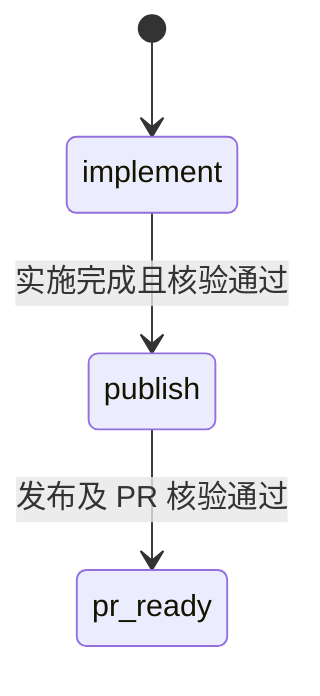
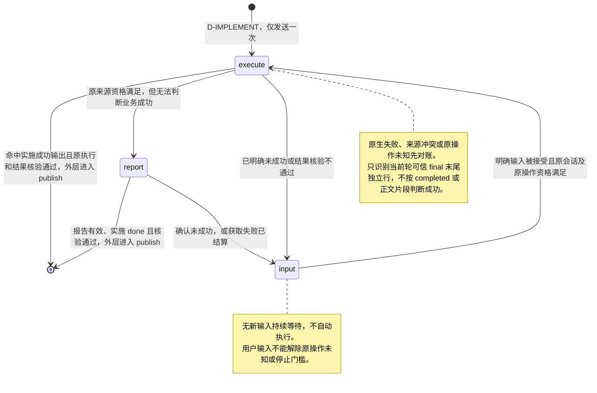
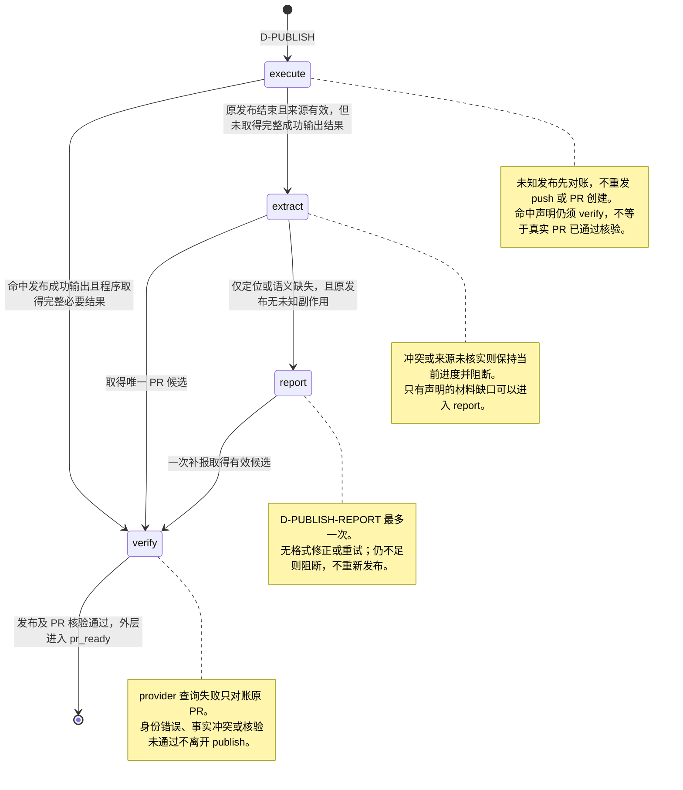
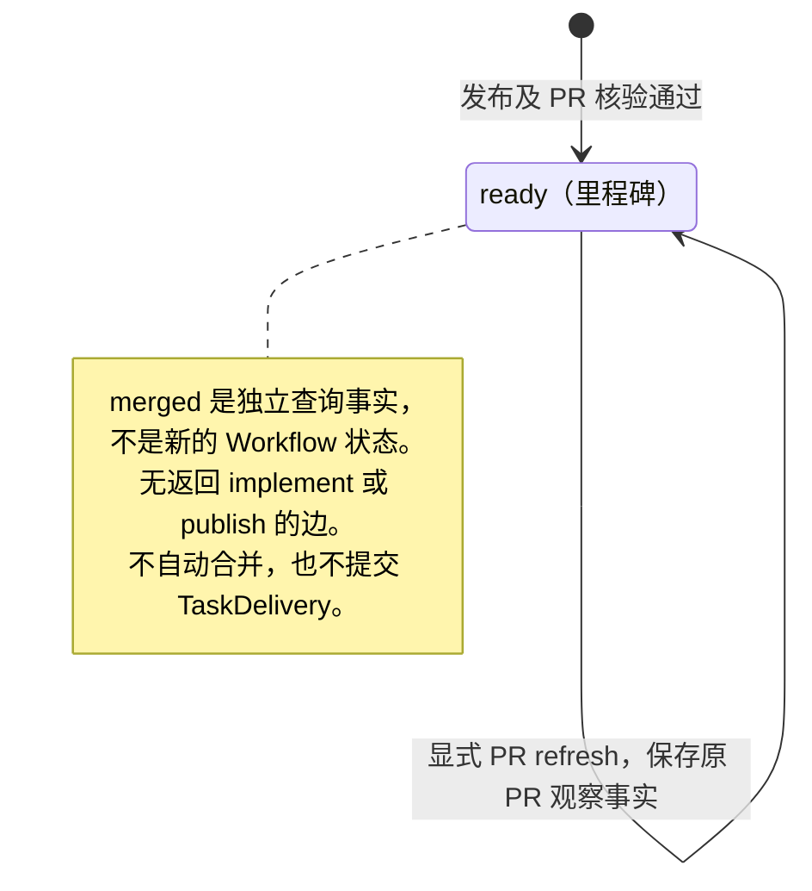

# Workflow：development（确认稿）

> 实施状态（2026-10-18）：已按确认的最小边界实现并完成必要验证。原生权限、行为约定和事后检测见总 Spec §6；当前支持 Windows / Codex >= 0.159.2，默认关闭独立解析。实际支持范围、失败修正及最终证据见[验收登记](../acceptance/result-acquisition.md)。历史“仅设计”说明指此前设计轮次。
日期：2026-10-17（首次设计 2026-10-16）。实施前业务基线 `development/1`；下文为已接线的 `development/2` 状态机定义。[统一能力与边界](README.md) · [带审计版本](development-audited.md) · [总 Spec](../spec/result-acquisition.spec.md)。本文件是独立流程说明，业务条件与提示词属于本定义，执行机制全部使用统一能力。

## 1. 实施前基线与本定义

实施前 `workflow/route.go` 在实施完成后固定创建 implement.report，再发布；publish 要求 JSON，格式错误补一次 publish.report。本确认稿按用户逐步核对的理解，区分外层业务状态与阶段内部状态。development 只选择可信 final 的成功输出识别与原 agent report，不选择独立 LLM 解析。implement 命中成功声明且核验通过直接完成；无法判断时直接 report，确认未成功统一 input 等用户，不细分自动处置原因。

本图的阶段/内部状态为同一游标的分组视图；Workflow.StepID 是唯一当前业务位置，外层、Status/Phase、获取尝试和 NextStage 按[总 Spec §2.3](../spec/result-acquisition.spec.md)由同一 actor 提交/投影，恢复不从最近报告反推阶段。首期只用内置核验，无定制脚本端口或宿主。

共同 worktree/原执行会话准备不在本图重写。此流程不要求审计模型、不增加独立审计或自动修复循环。`pr_ready` 是 Runner 里程碑，合并与 TaskDelivery 沿现外部职责。

## 2. Workflow 整体状态图



这张图只表示 Workflow 整体业务切换，只有 implement → publish → pr_ready；本 Workflow 不设计 pr_ready 返回 implement 的边。execute、report、input 是 implement 内部状态，等待输入时外层仍是 implement。各外层状态的内部状态图分别见下文，不在整体图展开。pr_ready 是现有里程碑，不新增自动合并或交付行为；publish 其他内部规则仍待后续单独核对。

## 3. implement 的内部状态机

进入外层 implement 时使用 D-IMPLEMENT 提示词，并进入内部 execute。进入提示词就是本次执行输入，只发送一次，不再分别发送“进入 implement”和“启动 execute”两轮。等待输入后，只有本次明确答案/继续指示已授权且原会话资格满足，才生成下一次 execute 输入。



图中结束点只表示 implement 完成，由外层进入 publish。成功输出识别与核验是 execute 结束时调用的统一能力，不额外发提示词或创建报告轮。未命中不等于失败，无法判断时直接 report；可信来源不可用/冲突或操作未知仍先对账，不走补报来解除门槛。每个源实施最多一次 report，无格式修正或重试回路；input 返回 execute 才是明确用户输入触发的新执行。

| 内部状态 | 使用的统一能力 / 提示词 | 核验与处理 | 内部去向 / 外层出口 |
| --- | --- | --- | --- |
| `execute` | PromptExecutionAgent / D-IMPLEMENT，结束后 RecognizeSuccessOutput + VerifyResult；原执行模型和会话 | 核实原生轮次/来源/原操作，识别阶段成功声明并核验必要结果；保留原 final 及命中依据 | 命中且原执行/结果核验通过 → implement 完成，外层 publish，无额外结果获取模型调用；未命中/信息不足而无法判断 → report；已确认未成功/核验失败 → input；技术未知/冲突沿原门槛处理 |
| `report` | PromptExecutionAgent / D-REPORT；原会话整理原实施 | 原 agent 利用已有上下文直接给出结构结果；程序按契约解码/核验，不调用独立 LLM 解析。只整理原结果，每源最多一次，不追加格式修正或重试 | 报告有效、实施 done 且核验通过 → implement 完成，外层 publish；报告确认未成功 → input；报告格式无效/信息不足等已结算的获取失败 → input，不自动回 execute |
| `input` | 现有问题展示/reply 授权能力；等待期间不给 agent 发新提示词 | 展示原材料中已知原因；原因不清楚也可等待下一步指示，不要求先精确分类。保留原生、业务、获取情况和来源，不把所有原 outcome 改写为 needs_input | 明确答案/继续指示被接受且原会话/原操作资格满足 → execute，D-IMPLEMENT 注入本次用户输入；没有输入则一直等待，不自动重跑 |

本期最小业务分流只有“成功，离开 implement”和“未成功，进入 input”；无法判断时用 report 补全判断，不新增独立解析、按失败原因自动修复或自动继续 execute。报告结构有效不等于业务成功。即便原输出没有明确提出问题，确认未完成也足以进入 input。

### 3.1 结果判断与核验边界

| 已取得的判断 | 本期处理 |
| --- | --- |
| 本轮 final 命中本阶段成功输出、原执行资格及必要结果核验通过 | 直接完成 implement，无需 report |
| 未命中成功输出或声明未提供完整必要结果，尚无法判断 | 不据此认定实施失败，直接 report；原生未知等仍先对账 |
| 原结果已明确未成功或必要结果核验不通过 | input，不为已知未成功再调用 report |
| 报告有效且确认实施完成，来源与结果核验通过 | implement 完成，允许外层切换 publish |
| 报告确认未完成或失败，原因清楚或不清楚 | 统一 input 等用户，不要求额外证明“需要输入” |
| 补报后仍不能形成有效结果，且相关操作均已结算 | input 展示获取缺口，不将材料不足记成业务失败 |
| 原生来源/原操作/停止未核实或事实冲突 | 维持原生命周期对账/阻断门槛，不能通过用户一句“继续”绕过；input 答案也不授权替换未知操作 |

input 对应外层仍为 implement、公开状态为 waiting_input。已有真实问题可直接展示；未成功但没有具体问题时，Workflow 以自身规则生成“本次实施尚未成功，请提供下一步指示”的等待说明，标记来源为 workflow_policy，附已知依据/缺口，不冒充执行 agent 提问。原 business outcome=blocked、未取得业务结论或获取 insufficient 等事实原样保留；未知不新增第四种业务 outcome；变化的是本定义选择等待输入。

V-NATIVE、V-SOURCE、V-RESULT、V-REPORT 复用[统一规则](README.md)。它们作为上述内部状态的核验绑定，不要求额外发送提示词，也不在整体图增加 `.result`/`.verify`/`.correct` 节点。外层状态与内部进度、来源、预算仍在同一 Run 原子提交，不另建子 Run 或恢复权威。

### 3.2 publish 的内部状态机（同步成功输出，其余沿上一稿待核对）

下图同步发布阶段的成功声明识别，保留程序提取和 provider 核验，不新增独立 parser 或重新发布的回边。本阶段最小结果包含唯一 PR URL/候选及来源；声明不能代替这些字段。发布处理沿本节核验和单次补报规则。



| publish 内部状态 | 统一能力 / 提示词 | 规则 |
| --- | --- | --- |
| execute（发布执行） | PromptExecutionAgent / D-PUBLISH，结束后 RecognizeSuccessOutput + ExtractResult | 必须 implement 完成且核验通过；命中声明且能程序取得本次唯一 PR URL 等必要结果 → verify，跳过额外获取模型；否则沿 extract。原生失败/冲突/未知不采纳声明，不重发发布 |
| extract（发布结果整理） | ExtractResult | 从原输出/PR clues 取唯一候选；不新增 head 反查接口；仅定位/语义不足且原发布无未知副作用时补报 |
| report（发布补报） | PromptExecutionAgent / D-PUBLISH-REPORT | 最多一次，只整理原发布；不重新 push/创建 PR，无格式修正或重试 |
| verify（PR 核验） | provider 查询 + VerifyResult | 无论来自成功输出或 extract/report 都复用 V-PR 与原发布核验，通过后外层进入 pr_ready；错误身份/冲突阻断，查询失败对账原目标；声明不覆盖外部事实 |

### 3.3 pr_ready 的内部状态图

pr_ready 是发布核验完成后的里程碑，没有待执行的业务子状态，也不给执行 agent 发送新的阶段提示词。下面用一个稳定状态表示其内部状态；显式 PR refresh 只更新同一已绑定 PR 的观察事实。



PR 查询失败继续按原目标对账，不触发新的实施或发布。外部合并与 TaskDelivery 保持既有职责，不在本图补设计后续流程。


## 4. 提示词正文与注入说明

`{{…}}` 数据由 Runner 注入且冻结；不要求调用方拼接。普通工作自然语言输出，结构化要求只放在报告状态。下列正文均须随定义版本维护；本定义没有独立解析提示词。

本 Workflow 的阶段成功输出如下；定义、注入和识别复用[统一能力 §4.1](README.md#41-阶段成功输出的定义注入和识别)，阶段只声明具体文本与结果契约。注入后的完整提示词见 D-IMPLEMENT/D-PUBLISH；不存在第二轮专门索取成功声明的调用。

| 外层阶段 | 最终回复末尾独立行（逐字匹配） | 采纳前仍须满足 |
| --- | --- | --- |
| implement | 实施及必要验证已完成。 | 原执行/来源资格、实施结果契约和已有结果核验；summary 保留原 final 及声明依据，不伪造逐项检查记录 |
| publish | 本次发布已完成。 | 原发布资格、程序可取得唯一 PR URL 等必要结果，以及 provider 身份核验 |
| pr_ready | 无 | 不执行 agent，不设置成功声明 |

报告提示词使用其结构契约，不追加自然语言成功行。报告轮的完成不替代原实施/发布资格。

### D-IMPLEMENT → implement 进入 / 内部 execute

```text
读取当前 worktree 中以下路径的 Spec、Plan 和参考材料，完成实现及必要验证。
材料（worktree 内的仓库相对路径）：{{material_refs}}
用户补充（如有）：{{authorized_feedback}}
完成实施及必要验证后，在最终回复末尾单独写一行：实施及必要验证已完成。
```

前三行表达实施任务、材料和本次用户补充，最后一行为本阶段约定的成功输出要求。工作区/来源仍由 Runner 提供并核验；未取得可采纳的成功输出且无法判断时直接 report。阶段声明不增加 JSON 收尾、不注入先前 PR 信息。

### D-REPORT → implement 内部 report

```text
根据你已有的执行上下文整理指定实施结果；只报告，不补做工作。
原实施：{{source_binding}}；材料：{{source_material_refs}}
契约：{{result_contract}}；输出结构：{{acquisition_output_schema}}
注明依据，保留已知失败、未知情况、缺失和冲突。
```

### D-PUBLISH → publish

```text
将当前分支 push 到发布目标并创建 PR。
实施结果：{{verified_implementation_result}}；发布目标：{{publication_binding}}
用 git branch --show-current 取得实际分支，作为远端分支和 PR head。
结果未知时说明情况，不重复创建。
成功后给出 PR URL，并在最终回复末尾单独写一行：本次发布已完成。
```

### D-PUBLISH-REPORT → publish.report

```text
根据已有上下文整理指定发布的结果和 PR URL；只报告，不重新发布。
原发布：{{source_binding}}；发布事实：{{publication_facts}}
契约：{{result_contract}}；输出结构：{{acquisition_output_schema}}
注明依据，保留已知失败、未知情况、缺失和冲突。
```

## 5. 等待、反馈、恢复与预算

执行原结果已明确未成功，或 report 确认未成功，就进入 implement 内的 input，不等待更精细的原因分类。活动 turn 内的原生问答仍对应原请求，不另发重复实施输入；执行结束后的 input 才由明确答案/继续指示触发下一 execute。本节的输入续执行仅指 implement 内 input → execute；pr_ready 不因实施反馈返回 implement。本 Workflow 不设计发布就绪后的返工路径。仅恢复获取保持原源与内部状态，不默认重做实施。技术 resume 不等于用户对本次未成功结果给出了继续实施指示。

stop 和原操作 unknown 优先于后继派发。兼容服务换代保留原授权、游标及等待状态，补收原事实后可自动接续已证明未派发的唯一后继；普通 in_flight 仍按可能已调用只对账。仅原状态或资源丢失要求人工恢复时才显式 resume，经原会话/旧写者核验后继续原授权范围，不重做实施或发布。已核实 PR 可以在流程未完成时独立绑定；这不直接越过发布核验。原始 final 始终保存，程序提取与报告结果单列。详见[当前换代契约](../spec/service-generation-recovery.spec.md)。

成功声明的识别/采纳不消耗模型调用，命中且核验通过时获取模型次数为 0。每个源实施、每次原发布分别最多 1 次 agent 报告，无格式修正或报告重试；不调用或探测独立 parser，也不依赖其配置/环境；不得仅凭原生 completed 或正文出现“完成”就判成功。用户输入后真正开始新的 execute 才建立新源和获取预算；重启/补读、resume 或再次查询不重置报告次数。报告无效或不足且操作已结算时，implement 进入 input，publish 保持阻断，不重做发布。

本轮已核对：外层仅 implement → publish → pr_ready，无 pr_ready 返工边；implement 内部为 execute、report、input。执行结束先识别可信 final 的阶段成功声明；命中且核验通过直接完成，无法判断直接 report，已明确未成功或报告未成功统一 input。development 不选独立解析；统一能力仍保留可信 final、独立解析、原 agent report 三种方式，其他 Workflow 可自行选择。publish 内部规则沿本节已确认定义；审计版按同样思路同步，只有审计结果获取保留独立解析。

## 当前实现映射

`definition.go` 保存内置定义，`.execute/.report/.input/.verify` 为可持久化的内部游标。图中的确定性 extract 动作在接收原 final 后与结果接受合并为同次原子提交，不为它排队、伪造 Turn 或另存提取进度；遇到 provider I/O 时已进入 publish.verify。`pr_ready` 保持单向里程碑。当前程序/报告接线的实际证据见[实施记录](../acceptance/evidence/result-acquisition-20261017/README.md)。
